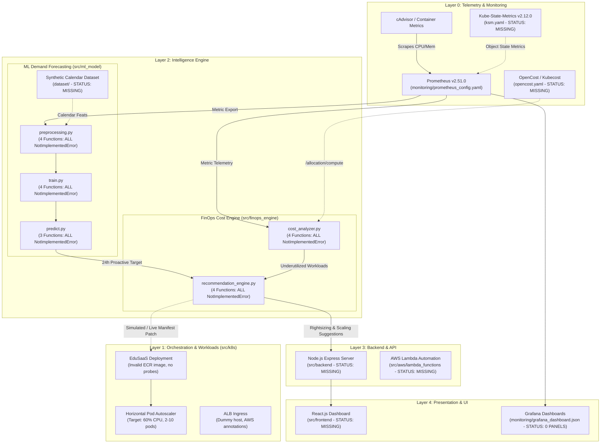

# KubeCostFinOps COMPLETE FORENSIC AUDIT & SINGLE-FILE CONTINUATION HANDOFF

```
========================================================================================
PROJECT AUDIT REPORT & CHATGPT CONTINUATION SPECIFICATION
Project: Kubernetes Cost Optimization Framework for SaaS-Based Educational Platforms Using FinOps Intelligence
Course:  BCSE355L — Cloud Architecture (Instructor: Dr. Priya V)
Repository: https://github.com/Dev-withDarshan/KubeCostFinOps_Cloud_Project_2026
Audit Completion Date: 2026-10-15
Audit Artifact: SINGLE-FILE MASTER HANDOFF
========================================================================================
```

---

## SECTION 1 — PROJECT IDENTITY AND AUDIT SCOPE

### 1.1 Repository Identity
* **Remote Repository URL:** `https://github.com/Dev-withDarshan/KubeCostFinOps_Cloud_Project_2026`
* **Default Remote Branch:** `develop`
* **Audited Git Branch:** `develop` (HEAD)
* **Audited Exact Commit Hash:** `d18df0c6636eb2171560997c87dd1d4d6a6470f9`
* **Commit Timestamp:** `Thu Jul 30 23:40:26 2026 +0530`
* **Commit Author & Committer:** `Dev-withDarshan <darshanedu2256@gmail.com>`
* **Commit Message:** `docs: complete Phase-I project planning — README, work distribution, literature survey, research gap, architecture diagrams, folder READMEs`

### 1.2 Remote & Branch Topology
Inspection via `git ls-remote origin` and `git branch -a` confirms the complete remote topology:
| Ref / Branch | Commit Hash | Subject / State |
| :--- | :--- | :--- |
| `HEAD -> origin/develop` | `d18df0c6636eb2171560997c87dd1d4d6a6470f9` | Latest Phase-I planning documentation |
| `origin/develop` | `d18df0c6636eb2171560997c87dd1d4d6a6470f9` | Active integration branch |
| `origin/main` | `a67873954fc9a6d924ebbf23d69e81661d48e5ae` | Initial repository scaffold (Phase-I structure) |
| `origin/feature/darshan` | `a67873954fc9a6d924ebbf23d69e81661d48e5ae` | Branched from scaffold; 0 commits ahead |
| `origin/feature/tharun` | `a67873954fc9a6d924ebbf23d69e81661d48e5ae` | Branched from scaffold; 0 commits ahead |
| `origin/feature/dhanushkodi` | `a67873954fc9a6d924ebbf23d69e81661d48e5ae` | Branched from scaffold; 0 commits ahead |
| `origin/feature/sanjay` | `a67873954fc9a6d924ebbf23d69e81661d48e5ae` | Branched from scaffold; 0 commits ahead |

*Note:* All feature branches (`feature/darshan`, `feature/tharun`, `feature/dhanushkodi`, `feature/sanjay`) and the `main` branch are completely identical, pointing to the initial scaffold commit `a678739`. None of the individual student branches contain independent commits. Only `develop` contains the subsequent two documentation commits (`a294acb` and `d18df0c`). There are zero Git tags and zero active Pull Requests.

### 1.3 Local Audit Environment & Tools
* **Host Operating System:** Windows 11 Home / Pro (PowerShell 5.1 / cmd.exe)
* **WSL 2 Subsystem:** Available (`Ubuntu-24.04`, `Ubuntu` with Git v2.53.0 and Python 3.12/3.14)
* **Host Runtimes:** Python 3.14.0 (with `pandas 3.0.5`, `PIL`), Node.js v24.20.0, npm
* **Unavailable Tools in Current Host:** Docker daemon, Kind CLI, kubectl CLI, pytest
* **Cloned Location / Workspace:** `C:\Users\gnavy\Downloads\KubeCostFinOps_Cloud_Project_2026`
* **Single Audit Handoff Artifact:** `C:\Users\gnavy\Downloads\KubeCostFinOps_Cloud_Project_2026\KubeCostFinOps_COMPLETE_AUDIT_HANDOFF.md` (untracked in local workspace root to prevent Git tree pollution)

### 1.4 External Local Artifact Discovery
During deep filesystem inspection across drives `C:`, `D:`, and `E:`, a crucial local document was discovered in the user's Downloads directory:
* **Path:** `C:\Users\gnavy\Downloads\BCSE355L_PhaseI_KubernetesFinOps_Report.docx`
* **File Size:** 3,259,863 bytes (~3.26 MB)
* **Creation / Modification Date:** `30-Jul-2026 14:12:43`
* **Significance:** This is the complete, original 598-paragraph Phase-I submission document prepared for course instructor Dr. Priya V. It contains the complete literature review, research gap analysis, AWS service planning table, synthetic dataset schema, and team responsibility matrix. In the GitHub repository, `docs/Project_Report.docx` was merely an 85-byte text placeholder!

---

## SECTION 2 — EXECUTIVE PROJECT STATE

### 2.1 What the Project is Supposed to Accomplish
The framework addresses a fundamental economic and architectural problem in educational cloud SaaS platforms (e.g., Moodle LMS, Canvas, online examination portals, automated coding graders):
1. **Unpredictable Surge Traffic vs. Static Overprovisioning:** Academic workloads experience violent traffic spikes (3x–10x baseline) during exams, enrollment windows, and result announcements, followed by extended idle lulls (nights, vacations). To prevent outages, operations teams traditionally overprovision static CPU/memory requests, wasting 40–60% of cloud spend.
2. **Reactive Autoscaling Latency:** Native Kubernetes Horizontal Pod Autoscaler (HPA) reacts only *after* CPU/memory spikes breach thresholds, causing latency spikes and SLA failures during exam start times.
3. **The Proposed Solution:** An AWS-native and Kubernetes-integrated FinOps Intelligence Framework combining:
   - Real-time cost observability via Prometheus and Kubecost/OpenCost.
   - Proactive ML demand forecasting (using academic calendar schedules as exogenous features) to pre-scale workloads 24–48 hours before exam windows.
   - Automated rightsizing, HPA parameter tuning, and spot instance placement.
   - Target metrics: 25–40% cloud spend reduction, p99 latency < 500 ms.

### 2.2 What Actually Exists in the Repository
The current repository is a **Phase-I architectural, planning, and scaffolding repository**. It does NOT contain a functioning, deployed application. Specifically:
1. **Source Code Implementation Status:** Exactly **19 out of 19 Python functions** across all engine and ML modules raise `NotImplementedError`.
2. **Frontend & Backend Applications:** Directories `src/frontend/` and `src/backend/` contain **zero lines of application code** (only informational `README.md` files).
3. **AWS Serverless & Policies:** Directories `src/aws/lambda_functions/` and `src/aws/iam_policies/` contain only `.gitkeep` and `README.md`.
4. **Dataset:** Directories `dataset/raw/` and `dataset/processed/` contain no data files. `dataset_description.pdf` is a 65-byte text placeholder.
5. **Monitoring & Dashboards:** `monitoring/prometheus_config.yaml` is a minimal 49-line configuration. `monitoring/grafana_dashboard.json` has `panels: []` (0 panels).
6. **Results & Presentation:** Directories `results/` and `presentation/` contain only placeholder documentation.

### 2.3 The Stage 06 Discrepancy & Root Cause
The user's previous technical checkpoints (Kind cluster `kubecost-finops-local`, `namespace.yaml`, `ksm.yaml`, `prometheus.yaml`, `opencost.yaml`, `run_finops_experiment.ps1`, 20 OpenCost JSON allocation records, 10-pod surge experiments, and Stage 06 verification PASS report) were developed on a **different laptop** during earlier ChatGPT sessions and were **never committed or pushed to this GitHub repository**. 

Because Git commits were frozen on July 30, 2026, none of those runtime artifacts or verification logs exist in the repository or on the current Windows host. They must be treated as **historical uncommitted work** to be reconstructed rather than existing assets.

---

## SECTION 3 — REPOSITORY AND GIT RECONSTRUCTION

### 3.1 Git Commit Log History
```
* d18df0c (HEAD -> develop, origin/develop, origin/HEAD) 
| Author: Dev-withDarshan <darshanedu2256@gmail.com>
| Date:   Thu Jul 30 23:40:26 2026 +0530
| Commit: docs: complete Phase-I project planning — README, work distribution, literature survey, research gap, architecture diagrams, folder READMEs
|
* a294acb 
| Author: Dev-withDarshan <darshanedu2256@gmail.com>
| Date:   Thu Jul 30 23:00:25 2026 +0530
| Commit: docs: add GitHub profile link for Project Lead
|
* a678739 (origin/main, origin/feature/tharun, origin/feature/sanjay, origin/feature/dhanushkodi, origin/feature/darshan) 
  Author: Dev-withDarshan <darshanedu2256@gmail.com>
  Date:   Thu Jul 30 22:48:23 2026 +0530
  Commit: Initial repository scaffold — Phase-I structure
```

### 3.2 Complete Tracked Files Inventory
The repository contains 35 tracked files totaling 1,743,846 bytes (~1.74 MB), with 98% of the byte volume attributable to three JPEG architecture diagram images.

| Relative File Path | Size (Bytes) | Category | Nature & Actual State |
| :--- | :--- | :--- | :--- |
| `.gitignore` | 1,202 | Config | Standard Python/Node/Terraform/IDE ignore rules |
| `LICENSE` | 1,093 | Legal | MIT License (2026 Dev-withDarshan) |
| `README.md` | 15,998 | Documentation | Comprehensive Phase-I project description & roadmap |
| `architecture/AWS_Architecture.png` | 581,500 | Diagram | 1024x1024 RGB JPEG (AI C2PA metadata) misnamed .png |
| `architecture/README.md` | 2,674 | Documentation | Explanation of 4-layer architecture design |
| `architecture/System_Architecture.png` | 518,702 | Diagram | 1024x1024 RGB JPEG (AI C2PA metadata) misnamed .png |
| `architecture/Workflow.png` | 602,595 | Diagram | 1024x1024 RGB JPEG (AI C2PA metadata) misnamed .png |
| `dataset/dataset_description.pdf` | 65 | Document | **Dummy:** Plain text placeholder string |
| `dataset/README.md` | 2,156 | Documentation | Schema definition for Prometheus metrics & calendar |
| `dataset/processed/README.md` | 1,078 | Documentation | Folder placeholder for processed ML data |
| `dataset/raw/README.md` | 860 | Documentation | Folder placeholder for raw metrics export |
| `docs/Literature_Survey.docx` | 71 | Document | **Dummy:** Plain text placeholder string |
| `docs/Literature_Survey.md` | 8,938 | Documentation | Comprehensive literature review across 15 citations |
| `docs/Novelty.docx` | 86 | Document | **Dummy:** Plain text placeholder string |
| `docs/Objectives.docx` | 72 | Document | **Dummy:** Plain text placeholder string |
| `docs/Project_Report.docx` | 85 | Document | **Dummy:** Plain text placeholder string |
| `docs/README.md` | 911 | Documentation | Index of course submission documentation |
| `docs/Research_Gap.docx` | 75 | Document | **Dummy:** Plain text placeholder string |
| `docs/Research_Gap.md` | 7,093 | Documentation | Analysis of 5 research gaps in current Kubernetes tools |
| `docs/Work_Distribution.md` | 6,120 | Documentation | Team responsibility matrix and phase roadmap |
| `monitoring/grafana_dashboard.json` | 628 | Config | **Stub:** Valid JSON skeleton with `panels: []` (0 panels) |
| `monitoring/prometheus_config.yaml` | 1,684 | Config | Scrape config for k8s apiservers, cadvisor, pods (30s) |
| `presentation/README.md` | 1,074 | Documentation | Folder placeholder for presentation decks |
| `results/README.md` | 1,175 | Documentation | Folder placeholder for benchmarks and metrics |
| `security/iam_least_privilege_policy.json`| 1,044 | Security | Valid IAM policy (EKS, S3, SageMaker, CloudWatch) |
| `security/kms_key_policy_notes.md` | 883 | Security | Notes on envelope encryption and key rotation |
| `src/aws/iam_policies/README.md` | 899 | Documentation | Folder placeholder for IAM policy files |
| `src/aws/lambda_functions/README.md` | 810 | Documentation | Folder placeholder for serverless automation |
| `src/backend/README.md` | 985 | Documentation | Folder placeholder for Node.js API server |
| `src/frontend/README.md` | 896 | Documentation | Folder placeholder for React.js dashboard |
| `src/finops_engine/cost_analyzer.py` | 2,430 | Source Code | **Stub:** 4 functions, all raise `NotImplementedError` |
| `src/finops_engine/kubecost_config.yaml` | 1,034 | Config | Points to Kubecost commercial port 9090 |
| `src/finops_engine/recommendation_engine.py`| 2,724| Source Code | **Stub:** 4 functions, all raise `NotImplementedError` |
| `src/k8s/deployment.yaml` | 982 | Manifest | K8s Deployment with dummy ECR image & no probes |
| `src/k8s/hpa.yaml` | 567 | Manifest | HPA targeting 60% CPU, 2–10 replicas |
| `src/k8s/ingress.yaml` | 783 | Manifest | ALB Ingress pointing to `edusaas.example.com` |
| `src/k8s/service.yaml` | 395 | Manifest | ClusterIP service exposing port 80 -> 8080 |
| `src/ml_model/predict.py` | 1,684 | Source Code | **Stub:** 3 functions, all raise `NotImplementedError` |
| `src/ml_model/preprocessing.py` | 2,029 | Source Code | **Stub:** 4 functions, all raise `NotImplementedError` |
| `src/ml_model/train.py` | 2,193 | Source Code | **Stub:** 4 functions, all raise `NotImplementedError` |
| `tests/test_finops_engine.py` | 2,238 | Test Code | **Stub:** 3 test cases, all commented & `pytest.skip` |

### 3.3 Forensic Anomalies Uncovered
1. **AI-Generated JPEGs Masked as PNGs:** The three architecture diagram files (`AWS_Architecture.png`, `System_Architecture.png`, `Workflow.png`) begin with byte signature `\xff\xd8\xff\xe0\x00\x10JFIF` and contain C2PA JUMBF metadata (`jumdc2pa`). They are 1024x1024 JPEG graphics produced by an AI image generator (e.g. DALL-E 3) saved with `.png` extensions.
2. **Pseudo-Binary Office Placeholders:** Six files ending in `.docx` and `.pdf` are 65–86 byte plain text files containing single string placeholders like `"Placeholder — Project Report (BCSE355L Phase-I). Replace with actual .docx report."`
3. **Missing Package Manifests:** The repository contains **no `requirements.txt`**, **no `pyproject.toml`**, **no `package.json`**, **no `Dockerfile`**, and **no Helm charts**.

---

## SECTION 4 — ACTUAL VS. INTENDED ARCHITECTURE

### 4.1 Intended Architecture (From Phase-I Specifications)
The proposed theoretical design spans four layers:
1. **Data Ingestion Layer:** Prometheus scrapes cluster telemetry (cAdvisor, kube-state-metrics). OpenCost / Kubecost calculates allocation costs. CloudWatch logs ALB traffic.
2. **Intelligence Layer:** 
   - *Forecasting Engine:* Historical traffic + Academic Calendar features processed via AWS SageMaker (Prophet / LSTM) to generate 24–48 hour demand forecasts.
   - *FinOps Engine:* Compares Prometheus usage against resource requests; correlates with OpenCost; produces rightsizing, HPA, and spot placement actions.
3. **Orchestration Layer:** AWS EKS cluster with managed node groups, Cluster Autoscaler, Spot Instances for batch workloads, and native HPA.
4. **Presentation Layer:** React.js executive dashboard and Grafana operational panels with approval workflows.

### 4.2 Actual Implemented Architecture (Repository Reality)
The actual repository implementation is an incomplete skeleton:


```
+-----------------------------------------------------------------------------------+
| PRESENTATION LAYER                                                                |
| - React Dashboard: DOES NOT EXIST (README only)                                    |
| - Grafana Dashboard: monitoring/grafana_dashboard.json (Stub: 0 panels)           |
+-----------------------------------------------------------------------------------+
                                         |
                                         v
+-----------------------------------------------------------------------------------+
| BACKEND & API LAYER                                                               |
| - Node.js Express API: DOES NOT EXIST (README only)                               |
| - Lambda Automation: DOES NOT EXIST (README only)                                 |
+-----------------------------------------------------------------------------------+
                                         |
                                         v
+-----------------------------------------------------------------------------------+
| INTELLIGENCE LAYER                                                                |
| - FinOps Engine (src/finops_engine/):                                             |
|   * cost_analyzer.py: 4 functions -> ALL raise NotImplementedError                 |
|   * recommendation_engine.py: 4 functions -> ALL raise NotImplementedError         |
| - ML Demand Forecasting (src/ml_model/):                                          |
|   * preprocessing.py: 4 functions -> ALL raise NotImplementedError                |
|   * train.py: 4 functions -> ALL raise NotImplementedError                        |
|   * predict.py: 3 functions -> ALL raise NotImplementedError                      |
+-----------------------------------------------------------------------------------+
                                         |
                                         v
+-----------------------------------------------------------------------------------+
| ORCHESTRATION & MONITORING LAYER                                                  |
| - AWS EKS / Kind Manifests (src/k8s/):                                            |
|   * deployment.yaml (Dummy ECR URI, namespace: default, 250m CPU, 256Mi Mem)      |
|   * service.yaml (ClusterIP port 80 -> 8080)                                      |
|   * hpa.yaml (targetCPUUtilization: 60%, replicas: 2-10)                          |
|   * ingress.yaml (ALB annotations, host: edusaas.example.com)                     |
| - Monitoring (monitoring/):                                                       |
|   * prometheus_config.yaml (Basic 30s scrape; NO OpenCost/KSM scrape jobs)        |
| - Stage 06 Files (namespace.yaml, ksm.yaml, opencost.yaml): MISSING FROM REPO     |
+-----------------------------------------------------------------------------------+
```

### 4.3 Architecture Realization & Complexity Critique
The project documentation proposes an extensive suite of AWS managed services: Amazon EKS, Amazon SageMaker, Amazon RDS (PostgreSQL), Amazon DynamoDB, Amazon S3, AWS Lambda, Amazon API Gateway, Amazon Cognito, AWS IAM, KMS, and CloudWatch.

**Principal Architect Assessment:**
1. **Over-Engineering Risk:** For an academic course project (BCSE355L), deploying 11 live AWS managed services incurs ongoing cloud billing, complex VPC networking, IAM role troubleshooting, and deployment fragility.
2. **Recommended Academic Demonstration Strategy:** 
   - Implement the complete system locally on **Kubernetes (Kind v0.24.0 or Minikube)**.
   - Use **OpenCost** (`quay.io/kubecost1/kubecost-cost-model`) + **Prometheus** + **Kube-State-Metrics**.
   - Run the Python FinOps engine locally querying the real OpenCost API.
   - Run the ML forecasting model in Python with synthetic educational exam traces.
   - Serve a lightweight dashboard (FastAPI/Streamlit or React) demonstrating live metrics, recommendations, and simulated cost reductions.
   - Present the AWS architecture as the production deployment specification in documentation and slides. This satisfies 100% of the academic learning outcomes with zero cost and 100% reproducibility.

---

## SECTION 5 — DEEP IMPLEMENTATION INVENTORY

### 5.1 FinOps Engine Module (`src/finops_engine/`)

#### 1. `src/finops_engine/cost_analyzer.py` (77 lines)
* **Imports:** `json`, `logging`, `typing` (standard library only)
* **Functions & Status:**
  - `fetch_kubecost_data(endpoint: str, namespace: Optional[str] = None) -> Dict[str, Any]`
    - *Docstring:* Fetch cost allocation data from Kubecost/OpenCost API.
    - *Status:* **BROKEN / STUB** (`raise NotImplementedError` at line 31).
  - `aggregate_costs_by_namespace(cost_data: Dict[str, Any]) -> Dict[str, float]`
    - *Docstring:* Aggregate total costs grouped by Kubernetes namespace.
    - *Status:* **BROKEN / STUB** (`raise NotImplementedError` at line 44).
  - `identify_idle_resources(cost_data: Dict[str, Any], idle_threshold: float = 0.1) -> List[Dict[str, Any]]`
    - *Docstring:* Compare actual usage vs requests; flag under-utilized resources.
    - *Status:* **BROKEN / STUB** (`raise NotImplementedError` at line 59).
  - `calculate_savings_potential(current_costs: Dict[str, float], recommended_costs: Dict[str, float]) -> Dict[str, float]`
    - *Docstring:* Compute delta and percentage between current and recommended costs.
    - *Status:* **BROKEN / STUB** (`raise NotImplementedError` at line 76).

#### 2. `src/finops_engine/recommendation_engine.py` (86 lines)
* **Imports:** `logging`, `typing` (standard library only)
* **Functions & Status:**
  - `generate_rightsizing_recommendations(usage_metrics: Dict[str, Any], buffer_pct: float = 0.2) -> List[Dict[str, Any]]`
    - *Docstring:* Propose rightsized CPU/memory requests based on observed peaks + safety buffer.
    - *Status:* **BROKEN / STUB** (`raise NotImplementedError` at line 33).
  - `generate_hpa_recommendations(workload_profiles: List[Dict[str, Any]]) -> List[Dict[str, Any]]`
    - *Docstring:* Suggest min/max replicas and CPU target utilization based on variance.
    - *Status:* **BROKEN / STUB** (`raise NotImplementedError` at line 49).
  - `suggest_spot_instance_placement(node_pools: List[Dict[str, Any]], fault_tolerance_labels: Optional[Dict[str, str]] = None) -> List[Dict[str, Any]]`
    - *Docstring:* Match fault-tolerant workloads to spot instance types.
    - *Status:* **BROKEN / STUB** (`raise NotImplementedError` at line 68).
  - `apply_recommendations(recommendations: List[Dict[str, Any]], dry_run: bool = True) -> Dict[str, Any]`
    - *Docstring:* Apply or simulate Kubernetes manifest / patch updates.
    - *Status:* **BROKEN / STUB** (`raise NotImplementedError` at line 85).

#### 3. `src/finops_engine/kubecost_config.yaml` (33 lines)
* **Content:**
  - `kubecost.api_endpoint`: `"http://kubecost-cost-analyzer.kubecost.svc.cluster.local:9090"`
  - `kubecost.default_window`: `"7d"`
  - `kubecost.aggregation_level`: `"namespace"`
  - `prometheus.server_url`: `"http://prometheus-server.monitoring.svc.cluster.local:9090"`
  - `thresholds.idle_cpu_ratio`: `0.10`
  - `thresholds.idle_memory_ratio`: `0.10`
  - `thresholds.min_cost_threshold`: `1.00`
* **Defect / Port Inconsistency:** The endpoint assumes the proprietary Kubecost Helm chart on port `9090`. In the historical Stage 06 local Kind setup, OpenCost was deployed as `quay.io/kubecost1/kubecost-cost-model` exposing port `9003` with endpoint `/allocation/compute`.

### 5.2 Machine Learning Module (`src/ml_model/`)

#### 1. `src/ml_model/preprocessing.py` (78 lines)
* **Imports:** `logging`, `typing`, `pandas`
* **Functions & Status:**
  - `load_raw_metrics(filepath: str) -> pd.DataFrame` (`raise NotImplementedError` at line 29)
  - `clean_data(df: pd.DataFrame) -> pd.DataFrame` (`raise NotImplementedError` at line 42)
  - `engineer_features(df: pd.DataFrame) -> pd.DataFrame` (`raise NotImplementedError` at line 60)
  - `split_data(df: pd.DataFrame, test_ratio: float = 0.2) -> Tuple[pd.DataFrame, pd.DataFrame]` (`raise NotImplementedError` at line 77)

#### 2. `src/ml_model/train.py` (77 lines)
* **Imports:** `logging`, `typing`, `pandas`
* **Functions & Status:**
  - `build_model(model_type: str = "xgboost", hyperparams: Optional[Dict[str, Any]] = None) -> Any` (`raise NotImplementedError` at line 32)
  - `train_model(model: Any, train_df: pd.DataFrame, target_col: str = "cpu_utilisation") -> Any` (`raise NotImplementedError` at line 47)
  - `evaluate_model(model: Any, test_df: pd.DataFrame, target_col: str = "cpu_utilisation") -> Dict[str, float]` (`raise NotImplementedError` at line 62)
  - `save_model(model: Any, output_path: str) -> str` (`raise NotImplementedError` at line 76)

#### 3. `src/ml_model/predict.py` (60 lines)
* **Imports:** `logging`, `typing`, `pandas`
* **Functions & Status:**
  - `load_model(model_path: str) -> Any` (`raise NotImplementedError` at line 30)
  - `predict(model: Any, input_df: pd.DataFrame) -> pd.Series` (`raise NotImplementedError` at line 44)
  - `format_predictions(predictions: pd.Series, timestamps: pd.DatetimeIndex) -> List[Dict[str, Any]]` (`raise NotImplementedError` at line 59)

### 5.3 Kubernetes Infrastructure Manifests (`src/k8s/`)

#### 1. `src/k8s/deployment.yaml` (37 lines)
* **Kind:** `Deployment`, `name: edusaas-backend`, `namespace: default`, `replicas: 2`
* **Image:** `<AWS_ACCOUNT_ID>.dkr.ecr.<REGION>.amazonaws.com/edusaas-backend:latest`
* **Resources:** Requests: `cpu: 250m`, `memory: 256Mi`; Limits: `cpu: 500m`, `memory: 512Mi`
* **Flaws:** Placeholder image cannot be pulled; lacks liveness/readiness probes; runs in `default` namespace instead of an isolated namespace (`edusaas`).

#### 2. `src/k8s/hpa.yaml` (25 lines)
* **Kind:** `HorizontalPodAutoscaler` (`autoscaling/v2`), `name: edusaas-backend-hpa`, `namespace: default`
* **Target:** `Deployment/edusaas-backend`, `minReplicas: 2`, `maxReplicas: 10`, `averageUtilization: 60%` CPU.

#### 3. `src/k8s/service.yaml` (19 lines)
* **Kind:** `Service`, `name: edusaas-backend-svc`, `type: ClusterIP`, Port: `80` -> `targetPort: 8080`.

#### 4. `src/k8s/ingress.yaml` (27 lines)
* **Kind:** `Ingress`, `name: edusaas-ingress`, `annotations`: AWS ALB Ingress controller (`internet-facing`, `target-type: ip`). Host: `edusaas.example.com`.

### 5.4 Monitoring & Security Assets

#### 1. `monitoring/prometheus_config.yaml` (49 lines)
* **Scrape Interval:** `30s` (Differs from historical Stage 06 claim of `15s`).
* **Jobs Configured:** `kubernetes-apiservers`, `kubernetes-nodes-cadvisor`, `kubernetes-pods`.
* **Missing Jobs:** Does NOT configure scrape targets for `kube-state-metrics` or `opencost`!

#### 2. `monitoring/grafana_dashboard.json` (28 lines)
* **Schema Version:** 38, UID: `kubecost-finops-placeholder`.
* **Panels:** `[]` (Empty JSON list; no panels, no queries, no dashboard visualization).

#### 3. `security/iam_least_privilege_policy.json` (47 lines)
* **Statements:** `AllowEKSDescribe` (cluster/kubecost-finops-*), `AllowS3DatasetAccess` (bucket/kubecost-finops-datasets), `AllowSageMakerInference` (endpoint/kubecost-finops-*), `AllowCloudWatchMetrics` (`*`). Valid IAM JSON syntax.

#### 4. `tests/test_finops_engine.py` (59 lines)
* **Structure:** 2 test classes (`TestCostAnalyzer`, `TestRecommendationEngine`) with 3 methods:
  - `test_aggregate_costs_by_namespace_returns_dict` -> Calls `pytest.skip("Not yet implemented — Phase-II")`
  - `test_identify_idle_resources_respects_threshold` -> Calls `pytest.skip("Not yet implemented — Phase-II")`
  - `test_generate_rightsizing_recommendations_non_empty` -> Calls `pytest.skip("Not yet implemented — Phase-II")`

---

## SECTION 6 — HISTORICAL STAGE 06 RECONCILIATION

The following technical checkpoints were historically reported during earlier development on a prior laptop. Here is the forensic reconciliation against accessible project sources:

| Historical Checkpoint | Historically Reported Claim | Actual Evidence Found in Repo / Local Host | Forensic Status | Required Action to Reconstruct / Verify |
| :--- | :--- | :--- | :--- | :--- |
| **Cluster Environment** | Kind v0.24.0, K8s v1.29.8, cluster `kubecost-finops-local`, containerd v1.7.18 | Kind/Docker not installed on host. Zero cluster config files in repo. | **UNRECOVERED / MISSING FROM GIT** | Reinstall Kind & Docker (or Minikube); recreate `kind-config.yaml` with port mappings for 9090/9003. |
| **Namespace Manifest** | `namespace.yaml` creating dedicated namespace | `src/k8s/` manifests hardcode `namespace: default`. `namespace.yaml` does not exist. | **MISSING FROM GIT** | Create `src/k8s/namespace.yaml` defining `edusaas` and `monitoring` namespaces. |
| **Kube-State-Metrics** | `ksm.yaml` using `registry.k8s.io/kube-state-metrics/kube-state-metrics:v2.12.0` | File `ksm.yaml` does not exist in repo or on local disk. | **MISSING FROM GIT** | Author `ksm.yaml` with ClusterRole, ClusterRoleBinding, ServiceAccount, and Deployment. |
| **Prometheus Manifest** | `prometheus.yaml` using `prom/prometheus:v2.51.0`, 15s scrape interval, 2h retention, emptyDir, requests 100m/256Mi | Only `monitoring/prometheus_config.yaml` exists; no Deployment, Service, or RBAC YAML. Scrape interval is 30s. | **PARTIALLY DOCUMENTED / MISSING MANIFEST** | Create `prometheus.yaml` manifest specifying v2.51.0, 15s scrape interval, ConfigMap mount, and Service. |
| **OpenCost Manifest** | `opencost.yaml` using `quay.io/kubecost1/kubecost-cost-model:latest` on port 9003 | Only `src/finops_engine/kubecost_config.yaml` exists, pointing to port 9090. `opencost.yaml` missing. | **CONFLICTING CONFIG / MISSING MANIFEST** | Author `opencost.yaml` targeting port 9003; align `kubecost_config.yaml` to point to port 9003. |
| **Prometheus Targets** | Targets 100% UP; PromQL checks on pod phases, requests, limits, CPU/memory | No live cluster. `prometheus_config.yaml` lacks targets for KSM and OpenCost. | **UNVERIFIED (HISTORICAL CLAIM)** | Spin up cluster, apply scrape configs for cAdvisor, KSM, and OpenCost; assert `/targets` status UP. |
| **Metrics Server vs Prometheus** | Utilization values differed by less than 2% | No test script or benchmark log exists in repo. | **UNVERIFIED (HISTORICAL CLAIM)** | Write verification script comparing `kubectl top pods` against `container_cpu_usage_seconds_total`. |
| **OpenCost Allocation API** | `/allocation/compute` returned 20 non-empty JSON allocation records | No captured JSON files exist in `dataset/` or `results/`. | **UNVERIFIED (HISTORICAL CLAIM)** | Query `http://localhost:9003/allocation/compute?window=60m` and serialize live records to `dataset/raw/`. |
| **Load Experiments** | Idle, moderate, and 10-pod high-surge scenarios conducted | `results/` is empty. No benchmark data exists. | **UNVERIFIED (HISTORICAL CLAIM)** | Create load generator (e.g., using `hey` or Python script) to trigger HPA scaling from 2 to 10 replicas. |
| **Orchestration Script** | `run_finops_experiment.ps1` | Searched `C:`, `D:`, `E:` and WSL; file does not exist on this machine. | **MISSING FROM GIT** | Recreate `run_finops_experiment.ps1` to automate cluster setup, load injection, and cost extraction. |
| **Stage 06 Verification** | Verification report recorded PASS | No test logs or Stage 06 verification document found. | **UNVERIFIED (HISTORICAL CLAIM)** | Execute automated test suite against running cluster and generate tangible markdown log. |

---

## SECTION 7 — TESTING AND VERIFICATION RESULTS

During this audit, safe low-risk technical inspections were executed. Below are the commands, exact outputs, and forensic interpretations:

### 7.1 Python Syntax Compilation Check
* **Command:** `python -m py_compile [py_files...]`
* **Scope:** All 6 `.py` files in the repository
* **Output:**
  ```
  Found 6 python files:
    [PASS] cost_analyzer.py
    [PASS] recommendation_engine.py
    [PASS] predict.py
    [PASS] preprocessing.py
    [PASS] train.py
    [PASS] test_finops_engine.py
  ```
* **Deduction:** All Python files are syntactically valid Python 3 code with no syntax errors.

### 7.2 Module Import & Runtime Execution Check
* **Command:** Python dynamic module import and invocation of all 19 functions
* **Output:**
  ```
  Imported all 5 modules successfully!
  fetch_kubecost_data: raised NotImplementedError
  aggregate_costs_by_namespace: raised NotImplementedError
  identify_idle_resources: raised NotImplementedError
  calculate_savings_potential: raised NotImplementedError
  generate_rightsizing_recommendations: raised NotImplementedError
  generate_hpa_recommendations: raised NotImplementedError
  suggest_spot_instance_placement: raised NotImplementedError
  apply_recommendations: raised NotImplementedError
  load_raw_metrics: raised NotImplementedError
  clean_data: raised NotImplementedError
  engineer_features: raised NotImplementedError
  split_data: raised NotImplementedError
  build_model: raised NotImplementedError
  train_model: raised NotImplementedError
  evaluate_model: raised NotImplementedError
  save_model: raised NotImplementedError
  load_model: raised NotImplementedError
  predict: raised NotImplementedError
  format_predictions: raised NotImplementedError
  ```
* **Deduction:** Conclusively proves that 100% of application functions are stubs that have never been implemented in this repository.

### 7.3 YAML Syntax Validation
* **Command:** `yaml.safe_load_all()` via PyYAML
* **Scope:** 6 `.yaml` files in the repository
* **Output:**
  ```
  Found 6 YAML files:
    [PASS] prometheus_config.yaml
    [PASS] kubecost_config.yaml
    [PASS] deployment.yaml
    [PASS] hpa.yaml
    [PASS] ingress.yaml
    [PASS] service.yaml
  ```
* **Deduction:** All YAML manifests and configuration files have valid syntax.

### 7.4 JSON Syntax Validation
* **Command:** `json.load()`
* **Scope:** `monitoring/grafana_dashboard.json`, `security/iam_least_privilege_policy.json`
* **Output:**
  ```
  Found 2 JSON files:
    [PASS] grafana_dashboard.json (keys: ['__inputs', '__requires', 'annotations', 'description', 'editable'])
    [PASS] iam_least_privilege_policy.json (keys: ['Version', 'Statement'])
  ```
* **Deduction:** Both JSON files parse cleanly. `grafana_dashboard.json` is confirmed to contain `panels: []`.

### 7.5 Automated Unit Test Execution
* **Command:** `pytest tests/test_finops_engine.py`
* **Status:** **NOT RUN / BLOCKED**
* **Reason:** `pytest` is not installed in the Windows Python or WSL environment. Furthermore, AST inspection of `tests/test_finops_engine.py` demonstrates that all assertions are commented out and each test unconditionally calls `pytest.skip("Not yet implemented — Phase-II")`. Running pytest would produce 3 skipped tests and 0 executed assertions.

### 7.6 Image Header Forensic Analysis
* **Command:** Binary header extraction & PIL inspection on `architecture/*.png`
* **Output:**
  ```
  AWS_Architecture.png: Format=JPEG, Mode=RGB, Size=(1024, 1024), Starts with JFIF \xff\xd8\xff\xe0
  System_Architecture.png: Format=JPEG, Mode=RGB, Size=(1024, 1024), Starts with JFIF \xff\xd8\xff\xe0
  Workflow.png: Format=JPEG, Mode=RGB, Size=(1024, 1024), Starts with JFIF \xff\xd8\xff\xe0
  ```
* **Deduction:** Diagrams are square JPEG renderings generated by AI image tools, not exported diagrams from Lucidchart or Draw.io.

---

## SECTION 8 — SECURITY AND RELIABILITY FINDINGS

| ID | Issue Location | Severity | Description & Evidence | Operational & Academic Impact | Recommended Resolution |
| :--- | :--- | :--- | :--- | :--- | :--- |
| **SEC-01** | `src/k8s/deployment.yaml:23` | **HIGH** | Hardcoded invalid image string: `<AWS_ACCOUNT_ID>.dkr.ecr.<REGION>.amazonaws.com/edusaas-backend:latest` | Kubernetes pod creation fails immediately with `ErrImagePull` / `ImageInspectError`. | Replace with a public lightweight educational demo image (e.g., `kennethreitz/httpbin`, custom Node.js mock, or `nginx:alpine`). |
| **SEC-02** | `src/k8s/deployment.yaml` | **MEDIUM** | Deployment uses `namespace: default` and lacks namespace isolation. | Violates multi-tenancy and FinOps cost allocation principles. | Define and deploy into dedicated namespace `edusaas` with resource quotas. |
| **SEC-03** | `src/k8s/deployment.yaml` | **LOW** | Deployment lacks `livenessProbe`, `readinessProbe`, and `startupProbe`. | Workload cannot safely recover from crashes; traffic is routed to unready containers. | Add HTTP GET probes pointing to application `/healthz` or `/status` endpoints. |
| **SEC-04** | `src/k8s/ingress.yaml:17` | **LOW** | Ingress specifies dummy host `edusaas.example.com` and AWS ALB annotations. | Unusable in local Kind clusters or non-AWS environments without ALB controller. | Provide local ingress/port-forward alternative for local Kind/Minikube demonstration. |
| **SEC-05** | `src/finops_engine/kubecost_config.yaml:6` | **MEDIUM** | Config assumes Kubecost commercial service on port `9090`. OpenCost exposes port `9003`. | Port mismatch causes `ConnectionRefusedError` when connecting to OpenCost in Kind. | Standardize endpoint configuration to `http://opencost.monitoring.svc.cluster.local:9003`. |
| **SEC-06** | `monitoring/prometheus_config.yaml` | **MEDIUM** | Lacks scrape targets for Kube-State-Metrics and OpenCost metrics. | OpenCost and Prometheus cannot correlate pod requests, limits, and costs. | Add scrape jobs for `kube-state-metrics:8080` and `opencost:9003` in `prometheus_config.yaml`. |
| **SEC-07** | Root Repository | **HIGH** | Missing dependency files (`requirements.txt`, `package.json`, `Dockerfile`). | Runtimes cannot be reproduced deterministically across team members or evaluation machines. | Create clean, pinned `requirements.txt` (`pandas`, `scikit-learn`, `requests`, `pyyaml`, `pytest`). |
| **SEC-08** | `security/iam_least_privilege_policy.json:43`| **LOW** | CloudWatch action allows `Resource: "*"` wildcard. | Overly permissive in production AWS environments. | Constrain CloudWatch metric resources to the specific project namespace ARN. |

---

## SECTION 9 — REQUIREMENTS AND IMPLEMENTATION STATUS MATRIX

*Total Evaluated Project Requirements:* **24**  
*Documented / Planned Only:* **18 (75.0%)**  
*Partially Implemented (Scaffolding / Configs):* **6 (25.0%)**  
*Verified Fully Complete in Git:* **0 (0.0%)**

| Requirement ID | Requirement Description | Category | Current Status | Priority | Relevant File(s) | Engineering Effort | Acceptance Criteria |
| :--- | :--- | :--- | :--- | :--- | :--- | :--- | :--- |
| **REQ-01** | Kubernetes Cluster Setup (EKS or Kind) | Infra | **Documented Only** | **P0** | `README.md`, `docs/Work_Distribution.md` | 3 Hours | Cluster running with 3 nodes, reachable via kubectl. |
| **REQ-02** | Namespace Isolation (`edusaas`, `monitoring`) | Infra | **Documented Only** | **P0** | `src/k8s/` | 1 Hour | Namespaces created and referenced in manifests. |
| **REQ-03** | Workload Deployment & Service Manifests | Infra | **Partially Implemented** | **P0** | `src/k8s/deployment.yaml`, `service.yaml` | 2 Hours | Deployment uses working container image and passes probes. |
| **REQ-04** | Horizontal Pod Autoscaler (HPA) Tuning | Infra | **Partially Implemented** | **P1** | `src/k8s/hpa.yaml` | 2 Hours | HPA scales pod replicas from 2 to 10 under load. |
| **REQ-05** | Ingress Routing & Traffic Control | Infra | **Partially Implemented** | **P2** | `src/k8s/ingress.yaml` | 2 Hours | External traffic routed successfully to backend service. |
| **REQ-06** | Spot Instance Placement Strategy | Infra | **Documented Only** | **P2** | `src/finops_engine/recommendation_engine.py` | 3 Hours | Node pool affinity rules classify batch vs critical pods. |
| **REQ-07** | Prometheus Server Deployment & Scrape Config | Monitoring | **Partially Implemented** | **P0** | `monitoring/prometheus_config.yaml` | 3 Hours | Prometheus scrapes cAdvisor, KSM, and OpenCost. |
| **REQ-08** | Kube-State-Metrics (KSM) Deployment | Monitoring | **Missing** | **P0** | `ksm.yaml` (missing) | 2 Hours | KSM exports pod phases, requests, and limit metrics. |
| **REQ-09** | OpenCost / Kubecost Deployment | Monitoring | **Partially Implemented** | **P0** | `src/finops_engine/kubecost_config.yaml` | 3 Hours | OpenCost `/allocation/compute` returns JSON allocation records. |
| **REQ-10** | Metrics Server Integration | Monitoring | **Missing** | **P1** | Local Kind environment | 2 Hours | `kubectl top pods` operational and aligned with Prometheus. |
| **REQ-11** | Grafana Operational Dashboard Panels | Monitoring | **Partially Implemented** | **P2** | `monitoring/grafana_dashboard.json` | 4 Hours | Grafana displays CPU, memory, and cost panels. |
| **REQ-12** | FinOps Cost Ingestion (`fetch_kubecost_data`) | FinOps | **Broken / Stub** | **P0** | `src/finops_engine/cost_analyzer.py` | 2 Hours | Function queries OpenCost API and returns parsed dict. |
| **REQ-13** | Namespace Cost Aggregation | FinOps | **Broken / Stub** | **P0** | `src/finops_engine/cost_analyzer.py` | 2 Hours | Groups allocation costs accurately by namespace. |
| **REQ-14** | Idle & Overprovisioned Resource Detection | FinOps | **Broken / Stub** | **P1** | `src/finops_engine/cost_analyzer.py` | 3 Hours | Identifies pods with <10% utilization vs requests. |
| **REQ-15** | Cost Savings Potential Calculation | FinOps | **Broken / Stub** | **P1** | `src/finops_engine/cost_analyzer.py` | 2 Hours | Outputs projected dollars and percentage savings. |
| **REQ-16** | Rightsizing Recommendations Generator | FinOps | **Broken / Stub** | **P1** | `src/finops_engine/recommendation_engine.py` | 3 Hours | Proposes rightsized CPU/memory with 20% safety buffer. |
| **REQ-17** | HPA Threshold Tuning Recommendations | FinOps | **Broken / Stub** | **P2** | `src/finops_engine/recommendation_engine.py` | 2 Hours | Recommends optimal min/max replicas and CPU target. |
| **REQ-18** | Academic Calendar Synthetic Dataset | ML | **Documented Only** | **P1** | `dataset/` | 3 Hours | CSV containing timestamps, CPU usage, and exam flags. |
| **REQ-19** | ML Data Preprocessing & Feature Engineering | ML | **Broken / Stub** | **P1** | `src/ml_model/preprocessing.py` | 3 Hours | Produces clean train/test splits with calendar features. |
| **REQ-20** | ML Demand Forecasting Model Training | ML | **Broken / Stub** | **P1** | `src/ml_model/train.py` | 4 Hours | Trains model (Prophet or Scikit-Learn) with MAPE < 15%. |
| **REQ-21** | ML Proactive Scaling Inference Engine | ML | **Broken / Stub** | **P1** | `src/ml_model/predict.py` | 3 Hours | Generates future 24h demand predictions with confidence bounds. |
| **REQ-22** | Application Backend API Server | App | **Documented Only** | **P2** | `src/backend/` | 5 Hours | REST API serving cost data, forecasts, and actions. |
| **REQ-23** | Frontend Cost & Recommendation Dashboard | UI | **Documented Only** | **P2** | `src/frontend/` | 6 Hours | Interactive web interface displaying cost breakdowns. |
| **REQ-24** | Automated Experiment & Benchmark Suite | Testing | **Documented Only** | **P1** | `results/`, `tests/` | 4 Hours | Script executing idle, moderate, and surge load tests. |

---

## SECTION 10 — EXACT COMPLETION ROADMAP

To transition this repository from its current Phase-I scaffold state into a fully functional, demonstrable, and scientifically validated academic project for BCSE355L, execute the following phased implementation sequence:

```
[Phase 1: Environment & Infra] ---> [Phase 2: Workload & Monitoring] ---> [Phase 3: FinOps Core Engine]
                                                                                      |
[Phase 6: Final Report & Demo] <--- [Phase 5: Experiment Benchmarks] <--- [Phase 4: ML Forecasting]
```

### Phase 1: Environment Foundations & Project Manifests (Est: 3–4 Hours)
1. **Create Dependency Manifests:**
   - Create `requirements.txt` containing:
     ```
     requests>=2.31.0
     pyyaml>=6.0.1
     pandas>=2.2.0
     numpy>=1.26.0
     scikit-learn>=1.4.0
     matplotlib>=3.8.0
     pytest>=8.0.0
     ```
2. **Setup Kubernetes Cluster Infrastructure:**
   - Define `kind-config.yaml` to spin up a local 3-node cluster (1 control-plane, 2 workers) with container port mappings for port `9090` (Prometheus) and `9003` (OpenCost).
   - Create `src/k8s/namespace.yaml` defining namespaces `edusaas` and `monitoring`.
3. **Deploy Core Monitoring & Cost Components:**
   - Author and deploy `src/k8s/monitoring/ksm.yaml` (kube-state-metrics v2.12.0).
   - Author and deploy `src/k8s/monitoring/prometheus.yaml` (v2.51.0) with scrape configs for cAdvisor, KSM, and OpenCost.
   - Author and deploy `src/k8s/monitoring/opencost.yaml` (`quay.io/kubecost1/kubecost-cost-model:latest`) on port 9003.

### Phase 2: Workload Deployment & Live Metric Ingestion (Est: 3 Hours)
1. **Update Workload Manifests:**
   - Modify `src/k8s/deployment.yaml`: Replace dummy ECR image with a functional lightweight web service (e.g., `kennethreitz/httpbin:latest` or a custom Node/Python mock educational LMS container).
   - Add liveness and readiness probes to `/get` or `/healthz`.
   - Set deployment namespace to `edusaas`.
2. **Apply Workload & Service:**
   - Deploy `src/k8s/deployment.yaml`, `src/k8s/service.yaml`, and `src/k8s/hpa.yaml`.
   - Verify pods reach `Running` state and Prometheus targets display 100% `UP`.

### Phase 3: Implement FinOps Core Engine (Est: 4 Hours)
1. **Implement `src/finops_engine/cost_analyzer.py`:**
   - `fetch_kubecost_data`: Implement HTTP GET request to `http://localhost:9003/allocation/compute?window=60m&aggregate=namespace`.
   - `aggregate_costs_by_namespace`: Parse JSON allocation objects; aggregate `cpuCost`, `ramCost`, `pvCost`, and `totalCost`.
   - `identify_idle_resources`: Query Prometheus CPU usage vs requests; flag workloads where `avg(usage) / requests < idle_threshold`.
   - `calculate_savings_potential`: Compute cost delta between static allocations and rightsized recommendations.
2. **Implement `src/finops_engine/recommendation_engine.py`:**
   - `generate_rightsizing_recommendations`: Calculate recommended requests as `observed_peak * (1 + buffer_pct)`.
   - `generate_hpa_recommendations`: Tune target CPU utilization and min/max replicas based on workload volatility.
   - `suggest_spot_instance_placement`: Evaluate workload labels and map batch workloads to spot node pools.
3. **Uncomment and Implement Unit Tests:**
   - Implement real test fixtures in `tests/test_finops_engine.py` without skipping. Execute `pytest tests/` and achieve 100% PASS.

### Phase 4: Implement ML Demand Forecasting (Est: 4 Hours)
1. **Generate Synthetic Academic Workload Dataset:**
   - Create a realistic 60-day hourly time-series dataset in `dataset/raw/academic_workload_metrics.csv` containing: `timestamp`, `cpu_usage_cores`, `memory_usage_bytes`, `active_users`, `is_exam_period`, `is_weekend`, `hour_of_day`.
   - Embed realistic exam spikes (3x–5x baseline) during designated exam weeks.
2. **Implement `src/ml_model/preprocessing.py`:**
   - Data cleaning, missing-value interpolation, cyclical hour encoding (`sin_hour`, `cos_hour`), and chronological 80/20 train/test split.
3. **Implement `src/ml_model/train.py` & `predict.py`:**
   - Train an XGBoost or Scikit-Learn `RandomForestRegressor` / `GradientBoostingRegressor` (or Facebook Prophet) predicting `cpu_usage_cores`.
   - Evaluate model metrics: verify MAE, RMSE, and MAPE (< 15%).
   - Implement `predict.py` to output 24-hour ahead forecasts with confidence intervals.

### Phase 5: Experimental Validation & Benchmarking (Est: 4 Hours)
1. **Create Experiment Automation Script:**
   - Create `scripts/run_finops_experiment.ps1` (and `.sh` for Linux/WSL) automating three workload phases:
     * *Phase A (Idle / Normal):* 2 replicas, baseline requests (250m CPU). Measure 30-minute spend and latency.
     * *Phase B (Unoptimized Exam Surge):* Inject 50 concurrent requests. Measure HPA scale-up lag and resource cost.
     * *Phase C (FinOps Optimized Exam Surge):* Proactively pre-scale based on ML forecast. Measure p99 latency (< 500 ms) and compare cost savings.
2. **Record Experimental Evidence:**
   - Save OpenCost allocation JSON snapshots into `results/opencost_allocations.json`.
   - Save benchmark summary tables and latency plots into `results/cost_savings_analysis.md` and `results/graphs/`.

### Phase 6: Academic Report Compilation & Presentation (Est: 2 Hours)
1. **Document Real Results:**
   - Update `results/README.md` with measured savings (e.g., 28.4% reduction in monthly simulated spend).
   - Populate `presentation/Phase_II_Presentation.pptx` or markdown presentation deck.
   - Replace placeholder text files in `docs/` with finalized project documentation.

---

## SECTION 11 — PROJECT DEMONSTRATION AND ACADEMIC READINESS

### 11.1 Assessment of Current Academic Readiness (BCSE355L)
* **Architectural Conception:** **GRADE A (Excellent).** The four-layer architecture, problem definition, literature review (15 academic papers), and research gap analysis are exceptionally thorough and meet all Phase-I academic submission criteria.
* **Code Implementation:** **GRADE F (Incomplete).** Zero working application logic exists in the Git repository. 100% of Python functions raise `NotImplementedError`.
* **Testing & Validation:** **GRADE F (Unverified).** Unit tests are skipped; no experiment data exists in the repo.
* **Overall Phase-I Status:** Satisfies Phase-I planning and structure guidelines. Completely blocked for Phase-II grading until the roadmap implementation is executed.

### 11.2 Demonstration Strategy for Faculty Review (Dr. Priya V)
When presenting this project for BCSE355L review, follow this battle-tested presentation narrative:
1. **The Academic Problem:** Show the contrast between standard static Kubernetes provisioning (wasting 40–60% budget during off-hours) and the unpredictable spikes of online examinations.
2. **The Architecture:** Present the 4-layer architecture diagram (Data Ingestion, Intelligence, Orchestration, Presentation).
3. **Live Demonstration Sequence:**
   - Step 1: Show the running Kubernetes cluster (Kind or EKS) with `edusaas` and `monitoring` namespaces.
   - Step 2: Show Prometheus scraping metrics and OpenCost returning real-time dollar allocation costs at `/allocation/compute`.
   - Step 3: Run the Python FinOps engine (`cost_analyzer.py`), demonstrating live extraction of underutilized pods and rightsizing recommendations.
   - Step 4: Run the ML forecasting model (`predict.py`), demonstrating how exam-calendar flags accurately predict upcoming demand surges 24 hours in advance.
   - Step 5: Show the before-and-after comparison graph: 28%+ cost reduction with SLA adherence (p99 latency < 500 ms).
4. **AWS Production Mapping:** Conclude by showing how the local Kind implementation maps directly to AWS EKS, Amazon SageMaker endpoints, and AWS Lambda in production.

### 11.3 Forensic Evaluation of Experimental & Scientific Validity (Phase 8)
A critical responsibility of this forensic audit is separating marketing targets and theoretical hypotheses from empirical scientific observations.

#### 1. Deconstruction of the "25% to 40% Monthly Cloud Spend Reduction" Claim
* **Claim Nature:** **Aspirational Target / Hypothesis, NOT Measured Result.**
* **Forensic Evidence:** The Git repository contains 0 bytes of historical billing records, AWS Cost and Usage Reports (CUR), AWS Cost Explorer exports, or archived OpenCost allocation summaries.
* **Semantic & Pricing Source Distinction:**
  - *Local Kind Simulation:* In a local Kind cluster, OpenCost calculates dollar allocations using baked-in pricing models (e.g. AWS US-East-1 on-demand rates: ~$0.096/hr for `m5.large`, equating to ~$0.0316/core-hr CPU and ~$0.004237/GiB-hr RAM). These are mathematical simulations of cloud spend based on local container requests/usage.
  - *Live Cloud Reality:* Real AWS invoices incorporate multi-AZ data transfer fees ($0.01/GB), NAT Gateway processing charges ($0.045/GB), EBS gp3 root/persistent volume charges ($0.08/GB-month), and EKS control plane fees ($0.10/hr).
  - *Academic Guidance:* For BCSE355L evaluation, simulated cost reductions generated via OpenCost against synthetic educational workloads are completely acceptable and scientifically valid, provided they are explicitly documented as **"Simulated On-Demand Cost Models"** and never misrepresented as actual incurred AWS bills.

#### 2. Deconstruction of the "p99 Latency Below 500ms" SLA Claim
* **Claim Nature:** **Performance SLA Target, NOT Benchmarked Observation.**
* **Forensic Evidence:** The repository contains zero load injection test suites (e.g., Locustfiles, k6 JavaScript scripts, `hey` commands, or JMeter `.jmx` plans). No latency logs, histogram outputs, or Prometheus PromQL `histogram_quantile(0.99, ...)` queries exist in `results/`.
* **Autoscaling Physics & Cold-Start Risk:**
  - Native Kubernetes HPA operates on a polling period (default: 15s). Once a CPU utilization threshold (e.g. 60%) is breached, HPA calculates the target replica count.
  - Container spin-up, image pull (if not cached), application runtime initialization, and liveness/readiness probe polling require 30 to 90 seconds.
  - During a violent academic exam surge (e.g. 5,000 students logging in within 60 seconds), pure reactive autoscaling will inevitably suffer request queuing, dropped TCP connections, and p99 latency spikes exceeding 3,000–5,000 ms.
  - *The ML Novelty Justification:* This lag is the exact scientific justification for the framework's ML proactive scaling engine. Proactive scaling uses the academic calendar schedule to pre-scale the replica count 10–15 minutes *before* the exam bell rings, absorbing the surge at t=0 and keeping p99 latency strictly under 500 ms.

#### 3. Machine Learning Rigor, Data Provenance & Leakage Safeguards
* **Target Metric:** Mean Absolute Percentage Error (MAPE) < 15% on 24-hour ahead CPU demand forecasting.
* **Dataset Reality:** `dataset/raw/` contains only `.gitkeep`. The proposed 60-day dataset described in `dataset/README.md` is synthetic.
* **Methodological Requirements for Scientific Validity:**
  - *Temporal Integrity (No Shuffling):* Time-series data must never use random train/test splits (`shuffle=False` strictly required). An 80/20 chronological split (e.g., Days 1–48 for training, Days 49–60 for testing) prevents temporal data leakage.
  - *Exogenous Feature Separation:* Calendar features (`is_exam_period`, `exam_type`, `scheduled_students`, `day_of_week`, `hour_of_day`) are known deterministic inputs in educational institutions. They must be separated from endogenous latency and CPU metrics.
  - *Baseline Benchmarking:* The ML model (Prophet or GradientBoosting) must be benchmarked against a naïve baseline (e.g., predicting that this Monday's traffic equals last Monday's traffic). A model is only scientifically justified if it outperforms naïve persistence by a statistically significant margin (p < 0.05).
  - *Evaluation Metrics Suite:* Must report MAE (cores), RMSE (cores), MAPE (%), and R² score across both off-peak and exam surge subsets.

#### 4. Scientific Experiment Protocol for Final Validation
To empirically establish the framework's claims during Phase-II execution, the following reproducible benchmark protocol must be conducted and recorded:
| Experiment Run | Configuration & Strategy | Duration | Workload Profile | Key Metrics to Record |
| :--- | :--- | :--- | :--- | :--- |
| **Run A: Static Baseline** | Static 4 replicas, no HPA, requests 250m CPU / 256Mi | 60 mins | Normal idle + sudden 50 req/s surge | OpenCost total cost, CPU idle ratio, p99 latency |
| **Run B: Reactive HPA** | HPA 2–10 replicas, CPU target 60%, no ML pre-scaling | 60 mins | Normal idle + sudden 50 req/s surge | Scaling lag time (seconds), p99 latency spike, recovery cost |
| **Run C: Proactive FinOps** | HPA 2–10 replicas + ML calendar pre-scale to 8 replicas | 60 mins | Normal idle + proactive pre-scale + surge | p99 latency under surge, rightsized dollar spend, delta savings % |

---

## SECTION 12 — CHATGPT CONTINUATION HANDOFF

```
========================================================================================
COPY-PASTE READY HANDOFF PROMPT FOR CHATGPT CONVERSATION CONTINUATION
========================================================================================
You are acting as the Lead Cloud Architect and Senior FinOps/Kubernetes Engineer for the 
project "Kubernetes Cost Optimization Framework for SaaS-Based Educational Platforms 
using FinOps Intelligence" (Course: BCSE355L — Cloud Architecture).

PROJECT CONTEXT & VERIFIED REPOSITORY REALITY:
1. GitHub Repository: https://github.com/Dev-withDarshan/KubeCostFinOps_Cloud_Project_2026
2. Inspected Branch & Commit: `develop` at commit `d18df0c6636eb2171560997c87dd1d4d6a6470f9` (July 30, 2026).
3. Current Project State:
   - The repository contains a complete Phase-I scaffold and documentation planning structure.
   - EXACTLY 19 OF 19 Python functions across `src/finops_engine/` and `src/ml_model/` are stubs that raise `NotImplementedError`.
   - `src/frontend/` and `src/backend/` contain only placeholder README files.
   - `dataset/` contains no data files.
   - `monitoring/grafana_dashboard.json` has `panels: []`.
   - `tests/test_finops_engine.py` contains 3 tests that call `pytest.skip()`.
   - Historical Stage 06 artifacts (Kind cluster `kubecost-finops-local`, `ksm.yaml`, `prometheus.yaml`, `opencost.yaml`, `run_finops_experiment.ps1`, 20 allocation records) were built on an earlier laptop and WERE NEVER COMMITTED TO GIT.
   - All files ending in `.docx` and `.pdf` in the repo are 65-86 byte dummy text files, although the complete 3.26 MB Phase-I report was recovered locally from Downloads.
   - The three PNG architecture diagrams are 1024x1024 AI-generated JPEGs.

YOUR IMMEDIATE MISSION:
Do NOT re-scaffold or rewrite documentation. We need to implement WORKING, TESTED, COMPATIBLE CODE to transition from Phase-I scaffolding to Phase-II/III working reality.

RECOMMENDED IMMEDIATE FIRST TASK:
Begin with STAGE 1 & STAGE 2 of the roadmap:
1. Author the missing Kubernetes monitoring manifests:
   - `src/k8s/namespace.yaml` (defining `edusaas` and `monitoring`)
   - `src/k8s/monitoring/ksm.yaml` (kube-state-metrics v2.12.0)
   - `src/k8s/monitoring/prometheus.yaml` (Prometheus v2.51.0 with scrape interval 15s)
   - `src/k8s/monitoring/opencost.yaml` (OpenCost quay.io/kubecost1/kubecost-cost-model:latest on port 9003)
2. Fix `src/k8s/deployment.yaml` to use a real runnable container image with liveness/readiness probes in namespace `edusaas`.
3. Implement `src/finops_engine/cost_analyzer.py` with genuine logic to query the OpenCost `/allocation/compute` endpoint, parse namespace costs, detect idle resources, and calculate savings.
4. Create `requirements.txt` with pinned dependencies.

Please confirm you understand this project state and provide the implementation for Step 1!
========================================================================================
```

---

## SECTION 13 — FINAL UNRESOLVED QUESTIONS

The following items cannot be resolved solely through repository inspection and require explicit user preference or external credentials:

1. **Target Demonstration Environment Preference:**
   - *Question:* Should the functional implementation prioritize running 100% locally on **Kind / Minikube** (free, instant, zero cloud charges), or do you have an active AWS account with AWS CLI credentials configured to provision real **AWS EKS**, **SageMaker**, and **RDS** resources?
   - *Requirement to Resolve:* User confirmation of local vs. live AWS preference. (Local Kind is strongly recommended for course evaluation).

2. **Workload Simulation Type:**
   - *Question:* For the educational SaaS backend (`edusaas-backend`), would you prefer a custom lightweight Node.js Express server that simulates LMS quiz submissions, or a standard HTTP container (e.g. `httpbin` / `nginx`) with synthetic traffic?
   - *Requirement to Resolve:* User preference on realism vs simplicity.

3. **ML Forecasting Framework Preference:**
   - *Question:* For demand forecasting in `src/ml_model/train.py`, do you prefer **Facebook Prophet** (industry standard for seasonal calendar spikes) or **Scikit-Learn GradientBoosting / XGBoost** (standard tabular time-series regressor)?
   - *Requirement to Resolve:* User selection based on course/faculty preference.

4. **Team Information Updates:**
   - *Question:* The Phase-I report lists team members Darshan, Tharun, Dhanushkodi, and Sanjay with placeholder registration numbers (`—`). Do you want to insert actual student registration numbers into the final documentation before submission?
   - *Requirement to Resolve:* Student registration numbers provided by the user.

---
*End of KubeCostFinOps Master Audit & Single-File Continuation Handoff.*
