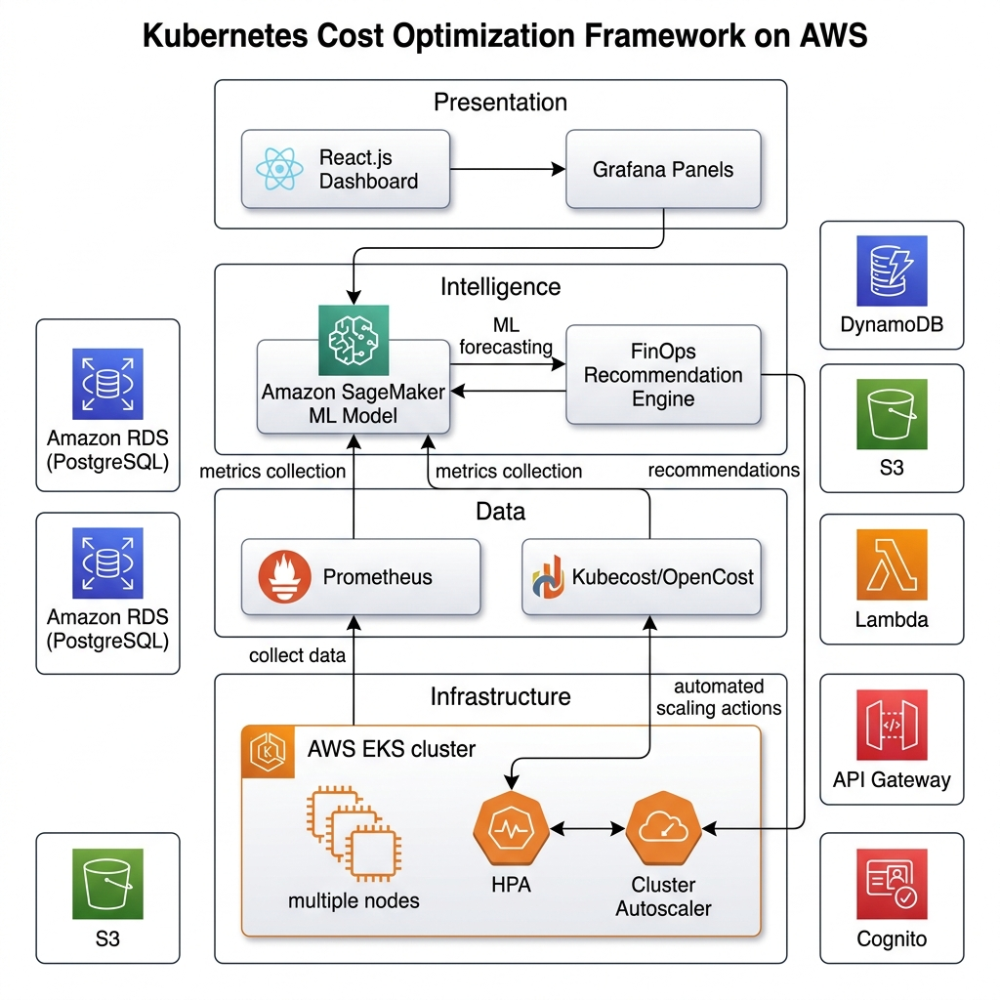
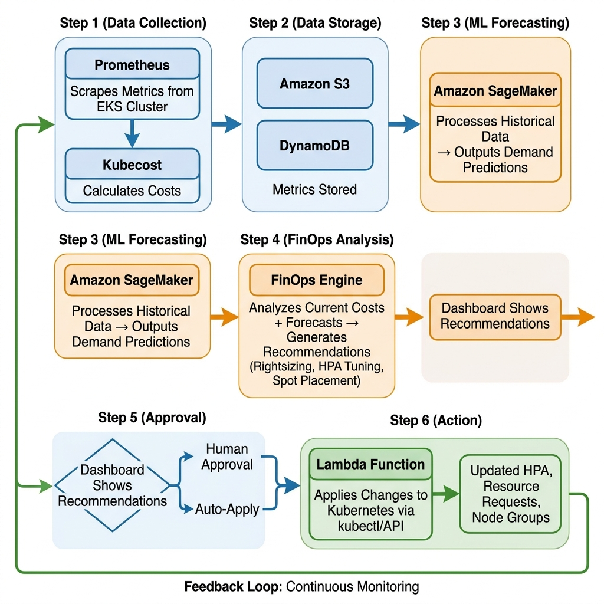

# Kubernetes Cost Optimization Framework for SaaS-Based Educational Platforms using FinOps Intelligence

> **Course:** BCSE355L — Cloud Architecture  
> **Phase:** Phase-I (Repository Scaffold)  
> **Due Date:** 30 July 2026

---

## Project Overview

This project implements a **Kubernetes Cost Optimization Framework** designed for SaaS-based educational platforms. The framework leverages **FinOps Intelligence** principles to forecast demand (e.g., exam-period traffic spikes), recommend rightsizing strategies, optimize autoscaling configurations, and manage spot-instance placement — all hosted on **AWS EKS**.

The system integrates **Prometheus** and **Kubecost/OpenCost** for real-time cost observability, and **Amazon SageMaker** for machine-learning-driven demand forecasting. A FinOps engine continuously analyzes cluster costs and generates actionable recommendations to reduce cloud spend without compromising performance or availability.

---

## Objectives

1. Design and deploy a Kubernetes-based infrastructure on AWS EKS tailored for educational SaaS workloads.
2. Implement real-time cost monitoring using Prometheus and Kubecost/OpenCost.
3. Build an ML-driven demand forecasting model (Amazon SageMaker) to predict traffic spikes during exam periods.
4. Develop a FinOps recommendation engine for Kubernetes rightsizing, HPA tuning, and spot-instance placement.
5. Achieve measurable cost savings while maintaining SLA-compliant performance for end users.

---

## Architecture

| Diagram | Description |
|---------|-------------|
|  | High-level AWS service topology |
|  | End-to-end system architecture |
|  | Data and decision workflow |

> **Note:** Architecture diagrams will be added in subsequent phases.

---

## Technology Stack

| Layer | Technologies |
|-------|-------------|
| **Cloud Provider** | Amazon Web Services (AWS) |
| **Container Orchestration** | Kubernetes (AWS EKS) |
| **Monitoring & Observability** | Prometheus, Grafana, Kubecost / OpenCost |
| **Machine Learning** | Amazon SageMaker, Python (scikit-learn, pandas, numpy) |
| **Backend** | Python (FinOps Engine), Node.js |
| **Frontend** | React.js |
| **Databases** | PostgreSQL (Amazon RDS), Amazon DynamoDB |
| **Storage** | Amazon S3 |
| **Auth & API** | Amazon Cognito, Amazon API Gateway |
| **Serverless** | AWS Lambda |
| **IaC / Config** | Kubernetes YAML manifests |

---

## AWS Services

- **Amazon EKS** — Managed Kubernetes control plane and worker nodes
- **AWS Lambda** — Serverless event-driven functions for automation tasks
- **Amazon RDS (PostgreSQL)** — Relational storage for application and cost data
- **Amazon DynamoDB** — NoSQL store for high-throughput metrics and state
- **Amazon S3** — Object storage for datasets, model artifacts, and logs
- **Amazon SageMaker** — ML model training, hosting, and inference
- **Amazon API Gateway** — RESTful API management
- **Amazon Cognito** — User authentication and authorization
- **AWS IAM & KMS** — Security, least-privilege policies, and encryption

---

## Repository Structure

```
KubeCostFinOps_Cloud_Project_2026/
├── README.md
├── LICENSE
├── .gitignore
├── docs/
│   ├── Project_Report.docx
│   ├── Literature_Survey.docx
│   ├── Research_Gap.docx
│   ├── Objectives.docx
│   └── Novelty.docx
├── architecture/
│   ├── AWS_Architecture.png
│   ├── System_Architecture.png
│   └── Workflow.png
├── dataset/
│   ├── raw/.gitkeep
│   ├── processed/.gitkeep
│   └── dataset_description.pdf
├── src/
│   ├── frontend/.gitkeep
│   ├── backend/.gitkeep
│   ├── finops_engine/
│   │   ├── cost_analyzer.py
│   │   ├── recommendation_engine.py
│   │   └── kubecost_config.yaml
│   ├── ml_model/
│   │   ├── preprocessing.py
│   │   ├── train.py
│   │   └── predict.py
│   ├── aws/
│   │   ├── lambda_functions/.gitkeep
│   │   └── iam_policies/.gitkeep
│   └── k8s/
│       ├── deployment.yaml
│       ├── service.yaml
│       ├── hpa.yaml
│       └── ingress.yaml
├── security/
│   ├── iam_least_privilege_policy.json
│   └── kms_key_policy_notes.md
├── monitoring/
│   ├── prometheus_config.yaml
│   └── grafana_dashboard.json
├── tests/
│   └── test_finops_engine.py
├── results/.gitkeep
└── presentation/.gitkeep
```

---

## Installation

> **Placeholder — Phase-II.** Installation instructions (Python dependencies, Node packages, AWS CLI configuration, kubectl setup) will be added once development begins.

---

## Deployment

> **Placeholder — Phase-II.** Deployment steps (EKS cluster provisioning, Helm chart installation for Prometheus/Kubecost, SageMaker endpoint creation, application deployment) will be documented here.

---

## Results

> **Placeholder — Phase-II.** Experimental results, cost-saving metrics, forecasting accuracy, and performance benchmarks will be presented here after implementation and testing.

---

## Future Scope

- **Multi-cloud support** — Extend the framework to GKE (Google Cloud) and AKS (Azure) for vendor-agnostic cost optimization.
- **Reinforcement Learning** — Replace rule-based recommendations with an RL agent that learns optimal scaling policies over time.
- **Real-time anomaly detection** — Integrate anomaly detection on cost and resource usage streams for proactive alerting.
- **Granular chargeback** — Implement namespace- and team-level cost allocation for multi-tenant educational platforms.
- **Custom Kubernetes Operator** — Build a CRD-based operator that applies FinOps recommendations as native Kubernetes resources.

---

## Contributors

| Name | Role |
|------|------|
| **Darshan** | Project Lead & Primary Cloud Architect |
| **Tharun** | Contributor |
| **Dhanushkodi** | Contributor |
| **Sanjay** | Contributor |

---

## License

This project is licensed under the **MIT License** — see the [LICENSE](LICENSE) file for details.
