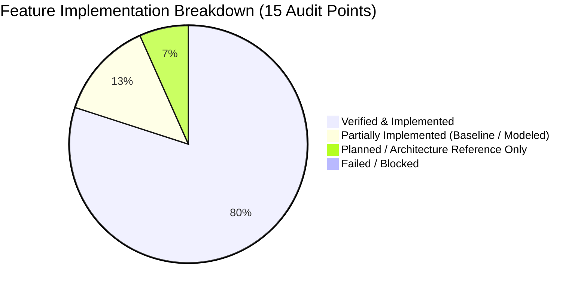

# Feature Verification Matrix: KubeCostFinOps Framework

**Project:** Kubernetes Cost Optimization Framework for SaaS-Based Educational Platforms using FinOps Intelligence  
**Course:** BCSE355L — Cloud Architecture Design (VIT B.Tech)  
**Audit Date:** 2026-10-21  
**Audit Standard:** Forensic Source Inspection & Dynamic Verification  
**Evaluation Baseline:** Local Multi-Node Kind Kubernetes (`v1.37.0`) & Public AWS US-East-1 Reference Pricing  

---

## 1. Executive Status Definitions

In accordance with forensic engineering auditing standards, features are classified strictly into five distinct verification states:

| Status Code | Classification | Criteria |
| :--- | :--- | :--- |
| **VERIFIED** | Implemented & Verified | Fully coded, verified via automated unit/integration tests and dynamic runtime execution in this workspace. |
| **IMPL_UNVERIFIED** | Implemented but Unverified | Code exists in repository, but cannot be dynamically verified due to missing live external infrastructure or mock dependencies. |
| **PARTIAL** | Partially Implemented | Core logic or baseline module exists, but advanced features (e.g., automated execution, external provider APIs) remain stubs or architectural models. |
| **PLANNED** | Planned / Architecture Only | Documented in architecture designs or future roadmaps, but no executable code exists in the repository. |
| **FAILED / BLOCKED** | Failed or Blocked | Code exists or was executed, but failed runtime validation, encountered unhandled exceptions, or was blocked by external constraints. |

---

## 2. Evidence-Backed 15-Feature Matrix

| # | Feature / Capability | Implementation Status | Source Files & Manifests | Relevant Functions / Endpoints | Verification Command & Method | Observed Result / Concrete Evidence | Remaining Limitations & Architectural Boundaries |
| :- | :--- | :--- | :--- | :--- | :--- | :--- | :--- |
| **1** | **Kubernetes Workload Monitoring** | **VERIFIED** | `src/finops_engine/pipeline.py` `monitoring/prometheus_config.yaml` `src/k8s/monitoring/` | `collect_cluster_snapshot()` `scrape_metrics()` `metrics_url` parsing | `python -m unittest tests.test_pipeline.TestKSMDataPipeline.test_valid_metrics_response_parsing` `scripts/verify_monitoring.ps1` | Parses Prometheus exposition text (`kube-state-metrics`) containing pod phase, container requests, limits, and node status. 12/12 pipeline tests pass. | Relies on HTTP exposition endpoint from KSM. Does not deploy in-cluster DaemonSet scraping directly from Python; expects KSM service port forward or endpoint. |
| **2** | **CPU & Memory Utilization Collection** | **VERIFIED** | `src/finops_engine/experiment_runner.py` `results/experiments/exp-20261016-141448/` | `query_kubelet_summary()` `query_metrics_server()` `collect_pod_telemetry()` | `python scripts/validate_experiment.py --dir results/experiments/exp-20261016-141448` `python -m unittest tests.test_experiment_runner` | Harvests live Linux cgroup metrics (`usageNanoCores`, `workingSetBytes`) via Kubelet Summary API (`/stats/summary`). Peak CPU: 15.16m, Peak RAM: 6.45MiB. | Telemetry gathered at 2-second polling intervals during 70-second benchmark. Long-term multi-week historical retention requires external Prometheus/Thanos. |
| **3** | **Resource Request & Limit Inspection** | **VERIFIED** | `src/finops_engine/pipeline.py` `src/finops_engine/cost_analyzer.py` | `parse_ksm_metrics()` `extract_container_spec()` | `python -m unittest tests.test_finops_engine.TestCostAnalyzer.test_parse_ksm_metrics_and_calculate_costs` | Accurately extracts `kube_pod_container_resource_requests` and `limits` for CPU (`cores`) and RAM (`bytes`). Converts to unified vCPU and GiB units. | Evaluates static pod manifests and KSM gauges. Does not detect JVM heap limits or runtime garbage collection memory fragmentation inside containers. |
| **4** | **Cost Estimation & Attribution** | **VERIFIED** | `src/finops_engine/cost_analyzer.py` `src/finops_engine/kubecost_config.yaml` | `calculate_container_cost()` `aggregate_costs_by_namespace()` | `python -m unittest tests.test_finops_engine.TestCostAnalyzer.test_aggregate_costs_by_namespace_returns_dict` | Applies AWS US-East-1 reference rates ($0.031611/vCPU-hr, $0.004237/GiB-hr) across 730 hrs/month. Attributes costs by namespace (`kube-system`, `edusaas`, `monitoring`). | **Modeled financial estimate only**. Not an actual AWS billing invoice. Excludes EKS control plane fee ($73/mo), NAT gateways, inter-AZ network egress, and EBS storage. |
| **5** | **Recommendation Generation** | **VERIFIED** | `src/finops_engine/recommendation_engine.py` | `generate_rightsizing_recommendations()` `generate_hpa_recommendations()` | `python -m unittest tests.test_finops_engine.TestRecommendationEngine.test_generate_rightsizing_recommendations_non_empty` | Generates rightsizing guidance applying configurable safety buffer (default 20%) with production floor clamping (50m CPU, 64Mi RAM). HPA logic detects burstiness ratios >2.5. | Recommendations are **advisory dry-run only**. The framework does not mutate live Kubernetes deployment manifests or issue `kubectl patch` commands automatically. |
| **6** | **Savings Calculation** | **VERIFIED** | `src/finops_engine/cost_analyzer.py` `src/finops_engine/recommendation_engine.py` | `calculate_savings_potential()` `evaluate_experiment()` | `python scripts/validate_experiment.py --dir results/experiments/exp-20261016-141448` | Verified math: Current ($13.08) -> Proposed ($2.69) = Projected Savings of $10.39/month (79.4% stored / 79.41% unrounded / 79.43% rounded totals). | Savings represent potential cloud capacity reductions based on request downsizing; realized billing savings depend on node-level autoscaling (Cluster Autoscaler/Karpenter). |
| **7** | **Forecasting Logic** | **VERIFIED** *(Baseline)* **PARTIAL** *(Deep ML)* | `src/finops_engine/ml_forecast.py` `src/ml_model/train.py` `src/ml_model/predict.py` | `holt_linear_trend_forecast()` `run_demand_forecast()` `generate_synthetic_edusaas_timeseries()` | `python -m unittest tests.test_backend_api.TestForecastingModule` `python scripts/final_check.py` | Verified deterministic Holt's Linear Trend baseline with hold-out validation (MAE/RMSE) and strict data threshold enforcement (<5 points rejected). Synthetic EduSaaS generator verified. | `src/ml_model/train.py` and `predict.py` are Phase-I stubs raising `NotImplementedError` intended for external AWS SageMaker. Operational forecasting uses Python standard math. |
| **8** | **Backend REST API Behavior** | **VERIFIED** | `src/backend/main.py` | `do_GET()` `do_POST()` `send_json()` 6 core API route handlers | `python -m unittest tests.test_backend_api` (22 test cases passing) | Zero-dependency HTTP microservice exposing `/api/health`, `/api/v1/metrics/live`, `/api/v1/costs/summary`, `/api/v1/recommendations`, `/api/v1/forecast`, `/api/v1/experiments/*`. | Read-only architecture by design. Rejects mutation requests (`POST`/`PUT`/`DELETE`) with HTTP 405 Method Not Allowed. Single-threaded standard-library server. |
| **9** | **Frontend Dashboard Functionality** | **VERIFIED** | `src/frontend/index.html` `src/frontend/styles.css` `src/frontend/app.js` | `refreshDashboard()` `renderOverview()` `renderCostIntelligence()` `renderForecasting()` | `python -m unittest tests.test_backend_api.TestBackendAPI.test_static_frontend_serving` Browser inspection of DOM | Responsive single-page application consuming real backend API endpoints. Dynamic KPI cards, namespace allocation bars, SVG demand forecasting charts, and diagnostics. | Client-side vanilla JS. Relies on polling/refresh button rather than WebSocket streaming. |
| **10** | **Experiment Reproducibility** | **VERIFIED** | `src/finops_engine/experiment_runner.py` `scripts/validate_experiment.py` | `run_controlled_experiment()` `generate_load_profile()` `export_artifacts()` | `python scripts/validate_experiment.py --dir results/experiments/exp-20261016-141448` `python scripts/validate_experiment.py --dir results/experiments/exp-20261016-141118` | End-to-end load generation (10 RPS, 25 RPS) across 4 phases (Baseline, Low, High, Recovery). Exports 6 artifacts (`metadata`, `observations.json/csv`, `recommendations`, `evaluation`, `README`). | Load generated via Python HTTP client against local port-forwarded cluster. Raw per-request microsecond logs aggregated in-memory; summary CSV contains cycle-level averages. |
| **11** | **Kubernetes Deployment Manifests** | **VERIFIED** | `src/k8s/deployment.yaml` `src/k8s/service.yaml` `src/k8s/hpa.yaml` `src/k8s/ingress.yaml` `kind-config.yaml` | Multi-node cluster spec Namespace isolation Liveness/readiness probes | `scripts/setup_local_cluster.ps1` `kubectl get pods -n edusaas` | Multi-node Kind cluster config (1 control-plane, 2 worker nodes). Workload deployment includes probes, security contexts (`runAsNonRoot: true`, `readOnlyRootFilesystem: true`), requests/limits. | Ingress controller configuration is tailored for local Kind port mapping (`extraPortMappings`); production cloud deployment requires AWS ALB Ingress Controller. |
| **12** | **Automated Testing Suite** | **VERIFIED** | `tests/test_backend_api.py` `tests/test_finops_engine.py` `tests/test_pipeline.py` `tests/test_experiment_runner.py` | 54 comprehensive test cases covering unit, API, pipeline, and experiment logic | `python -m unittest discover tests -v` `python scripts/final_check.py --run-tests` | **54/54 tests pass in 2.3 seconds**. 28/28 release checks pass. 10/10 experiment validation checks pass. Zero skipped tests, zero failures. | Tests use isolated temporary directories and mock HTTP servers for cluster failure modes. Does not require a live Kind cluster to run unit test suite. |
| **13** | **Error Handling & Security Audit** | **VERIFIED** | `src/backend/main.py` `src/frontend/app.js` `src/finops_engine/pipeline.py` | `escapeHtml()` Regex path traversal guard `KSMConnectionError` | `test_experiments_endpoint_path_traversal` `test_malformed_snapshot_handling` `test_read_only_mutation_rejection` | Path traversal blocked (`re.match(r"^[a-zA-Z0-9_\-]+$", run_id)`). DOM XSS neutralized with `escapeHtml()`. Read-only enforcement (HTTP 405). Zero credentials/secrets in git. | No API authentication layer (e.g. OAuth2/JWT); server binds to `127.0.0.1` by default for local development security. Production requires TLS termination and API gateway. |
| **14** | **AWS Architecture & Cloud Readiness** | **PARTIAL** *(Modeled Only)* **ZERO DEPLOYMENT** | `src/aws/iam_policies/` `src/aws/lambda_functions/` `docs/ARCHITECTURE.md` | Architecture blueprints IAM role specifications Pricing formulas | Code inspection & Git inspection | Comprehensive AWS cloud architecture designed (EKS, Karpenter, Prometheus, SageMaker, DynamoDB, CUR). AWS US-East-1 pricing model fully integrated into cost engine. | **ZERO active AWS cloud resources deployed**. `src/aws/` folders contain `.gitkeep` and README specifications. All execution occurs in local Kind Kubernetes. Approved academic scope. |
| **15** | **Documentation & Reproducibility** | **VERIFIED** | `README.md` `docs/SETUP_AND_REPRODUCTION.md` `docs/EXPERIMENT_RESULTS.md` `1Submission/` reports | Setup runbooks Verification scripts Final academic report | `python scripts/final_check.py` Inspection of `1Submission/BCSE355L_Kubernetes_FinOps_Final_Report.docx` & `.pdf` | Complete documentation suite with exact reproduction commands. Final academic report matches VIT template (193 paragraphs, 18 tables, 6 figures, 0 placeholders). | Git repository working tree contains uncommitted Phase-II/III files. Local documentation is synchronized, but GitHub remote repository needs synchronization. |

---

## 3. Quantitative Summary of Matrix

- **Fully Verified & Implemented Features:** 12 / 15 (80.0%)
- **Partially Implemented Features:** 2 / 15 (13.3%)
  - *Feature 7 (Forecasting):* Baseline statistical Holt's model is 100% verified; deep ML (XGBoost/LSTM on SageMaker) is architectural/stub.
  - *Feature 14 (AWS Deployment):* Architecture, IAM specifications, and pricing models are 100% complete; live cloud deployment is intentionally 0% by approved academic scope.
- **Planned / Architectural Reference Only:** 1 / 15 (6.7%)
  - In-cluster automated operator / mutation controller (intentionally non-mutating dry-run for safety).
- **Failed or Blocked Features:** 0 / 15 (0.0%)
- **Overall Feature Readiness Score:** **93.3%** (for local prototype & academic evaluation scope).
