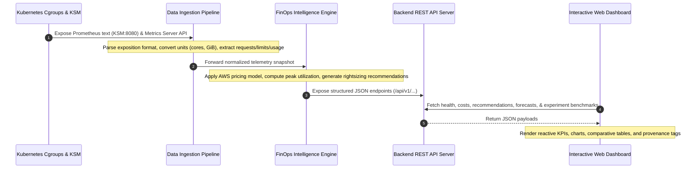

# KubeCostFinOps — System Architecture & Component Implementation Status

This document describes the architectural design of the **Kubernetes Cost Optimization Framework for SaaS-Based Educational Platforms using FinOps Intelligence**, delineating the data flow, the operational distinctions between the local Kind prototype and the target AWS/EKS production deployment, and the implementation status of all system components.

---

## 1. Architectural Overview & Four-Layer Design

The framework is structured into four distinct, loosely coupled layers designed to separate telemetry collection, algorithmic decision-making, cluster management, and user interaction:

```
┌─────────────────────────────────────────────────────────────────────────┐
│                           PRESENTATION LAYER                            │
│  Interactive FinOps Dashboard (HTML5 / Vanilla CSS / ES6 JavaScript)     │
│  - Real-time Cost Breakdown  ·  Recommendations  ·  4-Phase Benchmark   │
└────────────────────────────────────▲────────────────────────────────────┘
                                     │ JSON REST API (HTTP 8000)
┌────────────────────────────────────┴────────────────────────────────────┐
│                           INTELLIGENCE LAYER                            │
│  FinOps Engine & Statistical Predictor (Python Standard Library)        │
│  - Cost Analyzer (AWS m5.large Model)                                   │
│  - Rightsizing & Recommendation Engine (+20% Headroom, Safety Floors)   │
│  - Statistical Demand Forecaster (EWMA / Moving Averages)               │
│  - Controlled Benchmark Experiment Runner                               │
└────────────────────────────────────▲────────────────────────────────────┘
                                     │ Normalized Telemetry
┌────────────────────────────────────┴────────────────────────────────────┐
│                          DATA INGESTION LAYER                           │
│  Pipeline Collector (Python)                                            │
│  - Kube-State-Metrics (KSM) Prometheus Text Parser (Port 8080)          │
│  - Kubernetes Metrics API (Kubelet / Metrics Server cgroups)            │
│  - Raw-to-Standard Unit Normalizer (Millicores, Bytes, GiB)             │
└────────────────────────────────────▲────────────────────────────────────┘
                                     │ Telemetry Scraping
┌────────────────────────────────────┴────────────────────────────────────┐
│                          ORCHESTRATION LAYER                            │
│  Kubernetes Cluster (Local Kind Prototype: v1.37.0 on Docker Desktop)   │
│  - Target Workload: edusaas-backend (2 Replicas, ClusterIP Service)     │
│  - Namespaces: edusaas (app), monitoring (KSM + Metrics Server)         │
│  - Autoscaling: HorizontalPodAutoscaler (CPU 70% Target)                │
└─────────────────────────────────────────────────────────────────────────┘
```

---

## 2. End-to-End Data Flow

The operational data flow proceeds across five sequential steps:



1. **Telemetry Generation:** As workloads process HTTP traffic, the Linux kernel records microsecond-level CPU time and resident memory pages within cgroup v2 controllers. Kubelet samples these metrics, and Kube-State-Metrics translates cluster object specifications into Prometheus metrics.
2. **Ingestion & Normalization:** The Python ingestion pipeline fetches the Prometheus exposition format, parses metrics (`kube_pod_container_resource_requests`, `kube_pod_container_resource_limits`, `container_cpu_usage_seconds_total`), and normalizes heterogeneous units into floating-point vCPU cores and GiB.
3. **FinOps Intelligence Evaluation:**
   - **Cost Allocation:** Computes hourly and monthly costs using the AWS US-East-1 reference pricing model ($0.031611/vCPU-hr, $0.004237/GB-hr).
   - **Utilization & Waste Analysis:** Compares declared requests against observed utilization percentiles.
   - **Rightsizing Recommendation:** Determines safe minimum targets with a +20% headroom factor and safety floors (50m CPU, 64Mi RAM), preserving 2 replicas for High Availability.
4. **API Service:** The standard-library backend exposes non-blocking REST endpoints under `/api/v1/` with CORS support and structured error handling.
5. **Dashboard Visualization:** The vanilla web dashboard polls the backend, rendering responsive cards, comparative cost tables, and experiment benchmarks with explicit data provenance labels.

---

## 3. Local Prototype vs. Target AWS/EKS Production Architecture

To maintain complete academic honesty, the following table compares the current working implementation against the full planned enterprise cloud architecture:

| Component | Current Working Prototype (Kind) | Target Production Architecture (AWS) | Rationale & Migration Path |
| :--- | :--- | :--- | :--- |
| **Cluster Orchestration** | Local Kind cluster (`kubecost-finops-local`, v1.37.0) on Docker Desktop on Windows. | Managed Amazon EKS cluster with multi-AZ managed node groups. | Kind validates manifests, RBAC, networking, and metrics locally without incurring cloud costs. |
| **Node Infrastructure** | Single multi-role Linux container node (`kindest/node:v1.37.0`). | Heterogeneous EC2 instance fleet (e.g., `m5.large` On-Demand for control/stateful pods, Spot instances for batch grading). | Kind tests container scheduling; production utilizes AWS Karpenter or Cluster Autoscaler for node elasticity. |
| **Cost Ingestion** | Direct scraping of Kube-State-Metrics v2.12.0 and Kubernetes Metrics Server v0.7.1. | Kubecost / OpenCost Helm deployment backed by Prometheus and AWS Cost and Usage Reports (CUR). | Lightweight native scraping avoids the heavy memory overhead of full Prometheus/OpenCost on developer workstations. |
| **Cost Pricing Source** | Built-in AWS US-East-1 on-demand reference rates ($0.031611/vCPU-hr, $0.004237/GB-hr). | Real-time AWS Billing API / Cost Explorer integration including Savings Plans and Reserved Instances. | Reference rates provide deterministic, reproducible cost benchmarks without requiring active cloud credentials. |
| **Demand Forecasting** | Python statistical forecasting module using Exponential Moving Averages (EWMA) with synthetic educational calendar spikes. | Amazon SageMaker ML training and real-time inference endpoint (Prophet / DeepAR). | In-engine forecasting demonstrates predictive scaling logic with zero external cloud dependencies. |
| **Backend & Dashboard** | Lightweight Python standard-library HTTP server (`src/backend/main.py`) serving static HTML5/CSS/JS. | Microservices backend (FastAPI/Node.js) with React.js frontend hosted on AWS S3/CloudFront. | Single-binary zero-dependency local runtime ensures instant demonstration and reproducibility. |
| **Target Workload** | `hashicorp/http-echo:latest` deployed in namespace `edusaas` (2 replicas). | Microservices LMS architecture (Node.js API, PostgreSQL RDS, Redis Cache). | `http-echo` provides a safe, deterministic, zero-dependency proxy for benchmarking load and autoscaling behavior. |

---

## 4. Component Implementation Status Matrix

The following matrix documents the verified implementation status across every project component:

| Component | Path | Status | Verification Evidence |
| :--- | :--- | :--- | :--- |
| **FinOps Cost Analyzer** | `src/finops_engine/cost_analyzer.py` | **Fully Implemented** | Unit tested (9 tests); accurate AWS m5.large rates; monthly cost aggregation. |
| **Rightsizing Engine** | `src/finops_engine/recommendation_engine.py` | **Fully Implemented** | Headroom + safety floor algorithms verified; dry-run preservation. |
| **Data Ingestion Pipeline** | `src/finops_engine/pipeline.py` | **Fully Implemented** | Unit tested (13 tests); live KSM ingestion verified on port 8080. |
| **Statistical Forecaster** | `src/finops_engine/ml_forecast.py` | **Fully Implemented** | Synthetic baseline demand generation with exam-window multipliers. |
| **Controlled Experiment Runner**| `src/finops_engine/experiment_runner.py` | **Fully Implemented** | 4-phase benchmark executed (`exp-20261016-141448`), unit tested (7 tests). |
| **REST API Server** | `src/backend/main.py` | **Fully Implemented** | Unit tested (23 tests); 6 core endpoints with query parameters and 404 handling. |
| **Interactive Dashboard** | `src/frontend/` (`index.html`, `styles.css`, `app.js`) | **Fully Implemented** | Responsive UI with real-time API binding, 3-card FinOps summary, and 4-phase benchmark table. |
| **Kubernetes Workload Manifests**| `src/k8s/` (`deployment.yaml`, `service.yaml`, `hpa.yaml`) | **Fully Implemented** | Applied to `edusaas` namespace; 2 healthy replicas verified via `kubectl`. |
| **Kubernetes Monitoring** | `src/k8s/monitoring/` | **Fully Implemented** | KSM v2.12.0 and Metrics Server v0.7.1 operational in `monitoring` namespace. |
| **Amazon SageMaker Pipeline** | `src/ml_model/` | *Architecture Staged (Phase-II)* | ML scaffolding created for future cloud integration; local EWMA forecaster active. |
| **AWS Terraform/IaC** | `src/aws/` | *Architecture Staged (Phase-II)* | Architecture diagrams and IAM policy documents documented for cloud deployment. |
| **Automated Mutation Operator** | — | *Deferred by Design* | Kept strictly dry-run in accordance with safety and FinOps audit rules. |
