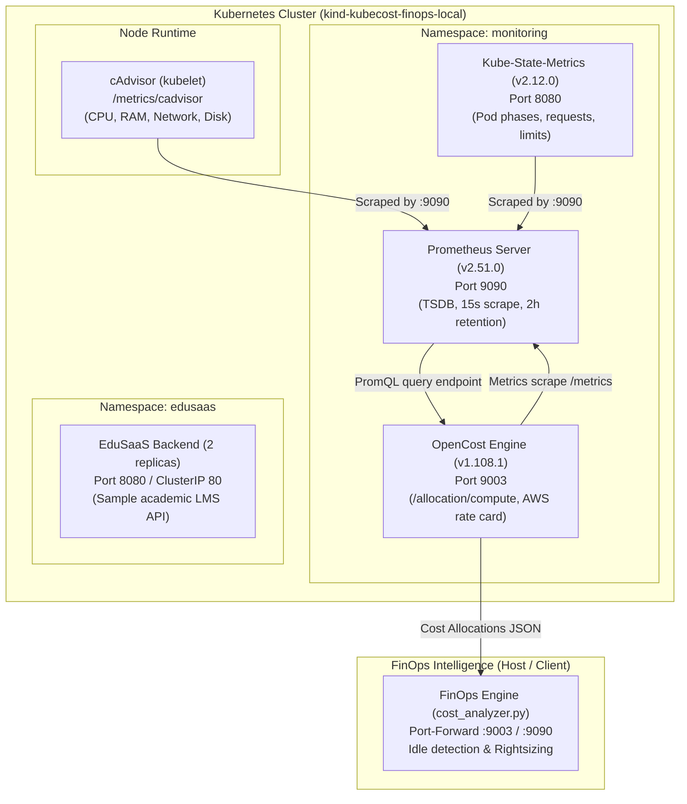

# Stage 06: Monitoring Infrastructure Implementation Guide

## 1. Executive Summary

Stage 06 implements the foundational monitoring and cost-observability telemetry layer for the **KubeCostFinOps** framework. This layer bridges low-level Kubernetes container runtime metrics, Kubernetes control-plane object states, and cloud billing rate cards into structured financial allocation records.

This operational runbook documents the deployment, configuration, verification, and troubleshooting of the monitoring stack in local development clusters (Kind) and production-aligned Kubernetes environments (AWS EKS).

---

## 2. Architecture & Telemetry Pipeline



### Component Roles

| Component | Image & Version | Port | Role & Telemetry Delivered |
| :--- | :--- | :--- | :--- |
| **Kube-State-Metrics** | `registry.k8s.io/kube-state-metrics/kube-state-metrics:v2.12.0` | `8080` (metrics)<br/>`8081` (telemetry) | Listens to the Kubernetes API server and generates object-state metrics: pod phases, container resource requests/limits, deployment replicas, and HPA target utilization. |
| **Prometheus Server** | `prom/prometheus:v2.51.0` | `9090` (web/API) | Time-series database scraping cAdvisor, KSM, and OpenCost at 15-second intervals with 2-hour retention for local low-memory execution. |
| **cAdvisor** | Embedded in Kubernetes Kubelet (`kindest/node`) | `10250` (via API proxy) | Measures instantaneous container CPU usage cores, memory working set bytes, network throughput, and filesystem IO. |
| **OpenCost** | `quay.io/kubecost1/kubecost-cost-model:v1.108.1` | `9003` (HTTP/API) | Correlates container resource utilization metrics from Prometheus with AWS rate-card models to output dollar cost allocations (`/allocation/compute`). |
| **EduSaaS Backend** | `hashicorp/http-echo:latest` (or custom LMS mock) | `8080` | Demonstrator academic workload deployed in namespace `edusaas` subject to ResourceQuota, LimitRange, and HPA autoscaling. |

---

## 3. Standardized Namespace & Service Endpoints

All manifests enforce standard, non-conflicting naming conventions across both cluster-internal DNS and local development port-forward mappings:

| Service Name | Namespace | Cluster-Internal DNS Endpoint | Port | External / Port-Forward URL |
| :--- | :--- | :--- | :--- | :--- |
| `kube-state-metrics` | `monitoring` | `kube-state-metrics.monitoring.svc.cluster.local:8080` | 8080 | `http://localhost:8080/metrics` |
| `prometheus-server` | `monitoring` | `prometheus-server.monitoring.svc.cluster.local:9090` | 9090 | `http://localhost:9090` |
| `opencost` | `monitoring` | `opencost.monitoring.svc.cluster.local:9003` | 9003 | `http://localhost:9003` |
| `edusaas-backend-svc` | `edusaas` | `edusaas-backend-svc.edusaas.svc.cluster.local:80` | 80 | `http://localhost:8080` |

> **Note on Port Mismatch Resolution:** Historical Kubecost bundled all-in-one stacks assumed port `9090`. OpenCost is standardized on port `9003` to eliminate port collision with Prometheus. `src/finops_engine/kubecost_config.yaml` is updated to point directly to `http://opencost.monitoring.svc.cluster.local:9003`.

---

## 4. Hardware Sizing & Local Cluster Design

Local development clusters must run reliably on memory-constrained workstations without triggering OOM crashes:

- **Host Specifications:** 16 GB Total RAM, Windows 11 with WSL2.
- **Topology:** Single control-plane node (`kind-config.yaml`). Kind automatically untaints single control-plane nodes, allowing all monitoring and application pods to schedule on one virtual node.
- **Memory Footprint:**
  - Control plane + Kubelet: ~450 MiB
  - Prometheus (2h retention): ~256 MiB
  - OpenCost: ~128 MiB
  - Kube-State-Metrics: ~64 MiB
  - EduSaaS Backend (2 pods): ~100 MiB
  - **Total Cluster Usage:** ~1.0–1.2 GiB RAM (well within a 2.0 GiB free headroom boundary).

---

## 5. Deployment Procedures

### Method A: Automated Deployment via PowerShell (Recommended for Windows)

From the repository root in PowerShell:

```powershell
# 1. Ensure Docker Desktop is running
# 2. Run the automated local cluster setup script:
powershell -ExecutionPolicy Bypass -File scripts/setup_local_cluster.ps1
```

The script automatically:
1. Validates prerequisites (Docker, Kind, kubectl, Python).
2. Creates the Kind cluster `kubecost-finops-local` if not already present.
3. Applies namespaces, quotas, and limits (`src/k8s/namespace.yaml`).
4. Deploys Kube-State-Metrics (`src/k8s/monitoring/ksm.yaml`) and waits for rollout.
5. Deploys Prometheus Server (`src/k8s/monitoring/prometheus.yaml`) and waits for rollout.
6. Deploys OpenCost (`src/k8s/monitoring/opencost.yaml`) and waits for rollout.
7. Deploys EduSaaS workload (`src/k8s/deployment.yaml`, `src/k8s/service.yaml`, `src/k8s/hpa.yaml`).

### Method B: Automated Deployment via Bash / WSL (Linux/WSL)

```bash
chmod +x scripts/setup_local_cluster.sh scripts/verify_monitoring.sh
./scripts/setup_local_cluster.sh
```

### Method C: Manual Step-by-Step Manifest Deployment

If preferred, deploy the manifests sequentially in exact dependency order:

```bash
# Step 1: Create Kind Cluster
kind create cluster --name kubecost-finops-local --config kind-config.yaml

# Step 2: Establish Namespaces & Limits
kubectl apply -f src/k8s/namespace.yaml

# Step 3: Deploy Kube-State-Metrics
kubectl apply -f src/k8s/monitoring/ksm.yaml
kubectl rollout status deployment/kube-state-metrics -n monitoring --timeout=120s

# Step 4: Deploy Prometheus Server
kubectl apply -f src/k8s/monitoring/prometheus.yaml
kubectl rollout status deployment/prometheus-server -n monitoring --timeout=120s

# Step 5: Deploy OpenCost Cost Allocation Engine
kubectl apply -f src/k8s/monitoring/opencost.yaml
kubectl rollout status deployment/opencost -n monitoring --timeout=180s

# Step 6: Deploy EduSaaS Sample Workload
kubectl apply -f src/k8s/deployment.yaml
kubectl apply -f src/k8s/service.yaml
kubectl apply -f src/k8s/hpa.yaml
kubectl rollout status deployment/edusaas-backend -n edusaas --timeout=120s
```

### Method D: OpenCost Deployment via Official Helm Chart

If Helm is available in your environment:

```bash
helm repo add opencost https://opencost.github.io/opencost-helm-chart
helm repo update
helm install opencost opencost/opencost \
  --namespace monitoring \
  --values src/k8s/monitoring/opencost-helm-values.yaml
```

---

## 6. Verification & Health Checking

### Running Automated Verification

Execute the verification utility:

```powershell
powershell -ExecutionPolicy Bypass -File scripts/verify_monitoring.ps1
```

Verification evidence and JSON summaries are saved to `results/stage_06/`.

### Manual Diagnostic Commands

#### 1. Check Pod Status and Events
```bash
kubectl get pods -n monitoring -o wide
kubectl get pods -n edusaas -o wide
```

#### 2. Verify Services and Endpoints
```bash
kubectl get svc,endpoints -n monitoring
kubectl get svc,endpoints -n edusaas
```

#### 3. Inspect Component Logs
```bash
# Kube-State-Metrics
kubectl logs -n monitoring -l app.kubernetes.io/name=kube-state-metrics --tail=50

# Prometheus Server
kubectl logs -n monitoring -l app.kubernetes.io/name=prometheus-server --tail=50

# OpenCost
kubectl logs -n monitoring -l app.kubernetes.io/name=opencost --tail=50
```

#### 4. Port Forwarding for External API Access
Open separate terminal windows:

```bash
# Forward Prometheus Web UI and API (port 9090)
kubectl port-forward svc/prometheus-server -n monitoring 9090:9090

# Forward OpenCost Allocation API (port 9003)
kubectl port-forward svc/opencost -n monitoring 9003:9003
```

#### 5. Verify Prometheus Scrape Targets
In a browser or via `curl`:
```bash
curl http://localhost:9090/api/v1/targets | jq .
```
Verify that targets `prometheus`, `kube-state-metrics`, `opencost`, and `kubernetes-nodes-cadvisor` report `health: "up"`.

#### 6. Query OpenCost Cost Allocation Compute API
```bash
# Request real-time hourly cost allocation across namespaces
curl -G "http://localhost:9003/allocation/compute" \
  --data-urlencode "window=1h" \
  --data-urlencode "aggregate=namespace" \
  --data-urlencode "accumulate=true"
```

Sample successful response:
```json
{
  "code": 200,
  "status": "success",
  "data": [
    {
      "edusaas": {
        "name": "edusaas",
        "cpuCost": 0.0158,
        "ramCost": 0.0021,
        "totalCost": 0.0179
      },
      "monitoring": {
        "name": "monitoring",
        "cpuCost": 0.0210,
        "ramCost": 0.0035,
        "totalCost": 0.0245
      }
    }
  ]
}
```

---

## 7. Troubleshooting Guide

### Issue 1: `docker` command fails with pipe or daemon error
- **Cause:** Docker Desktop is not running or crashed.
- **Fix:** Launch Docker Desktop from the Start Menu (`"C:\Program Files\Docker\Docker\Docker Desktop.exe"` or AppData). Verify that the Docker icon displays "Engine running" before creating clusters.

### Issue 2: Pod stuck in `Pending` state
- **Cause:** Insufficient CPU or memory allocatable on the Kind node.
- **Fix:** Inspect node resources: `kubectl describe node kubecost-finops-local-control-plane`. In single-node development, reduce pod replica count or adjust container limits down in `src/k8s/monitoring/prometheus.yaml` (e.g., memory requests 128Mi).

### Issue 3: Pod stuck in `ImagePullBackOff` or `ErrImagePull`
- **Cause:** Temporary network disruption or Docker Hub pull rate limit.
- **Fix:** Pre-pull the images on the host before Kind loading:
  ```powershell
  docker pull registry.k8s.io/kube-state-metrics/kube-state-metrics:v2.12.0
  docker pull prom/prometheus:v2.51.0
  docker pull quay.io/kubecost1/kubecost-cost-model:v1.108.1
  kind load docker-image registry.k8s.io/kube-state-metrics/kube-state-metrics:v2.12.0 --name kubecost-finops-local
  kind load docker-image prom/prometheus:v2.51.0 --name kubecost-finops-local
  kind load docker-image quay.io/kubecost1/kubecost-cost-model:v1.108.1 --name kubecost-finops-local
  ```

### Issue 4: OpenCost reports `failed to connect to Prometheus`
- **Cause:** DNS or port configuration error between OpenCost and Prometheus.
- **Fix:** Verify `PROMETHEUS_SERVER_ENDPOINT` in `src/k8s/monitoring/opencost.yaml` is set to `http://prometheus-server.monitoring.svc.cluster.local:9090` and that Service `prometheus-server` exists in namespace `monitoring`.

### Issue 5: Port 9090 or 9003 already bound on host
- **Cause:** A local background service or prior port-forward is occupying the port.
- **Fix:** Check active ports: `netstat -ano | findstr 9090` or `netstat -ano | findstr 9003`. Terminate the stale port-forward process or use an alternate local port mapping (e.g. `kubectl port-forward svc/opencost -n monitoring 9005:9003`).
